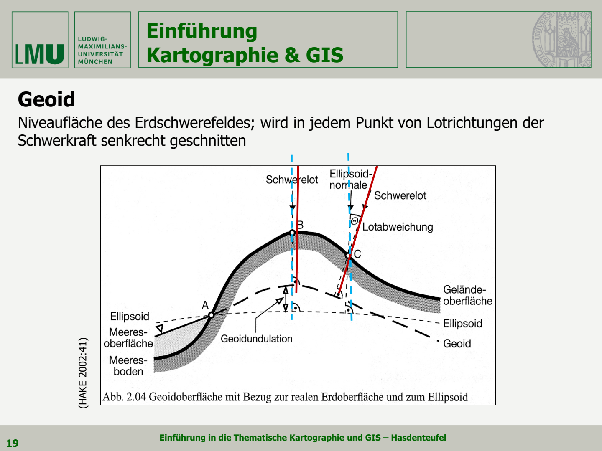
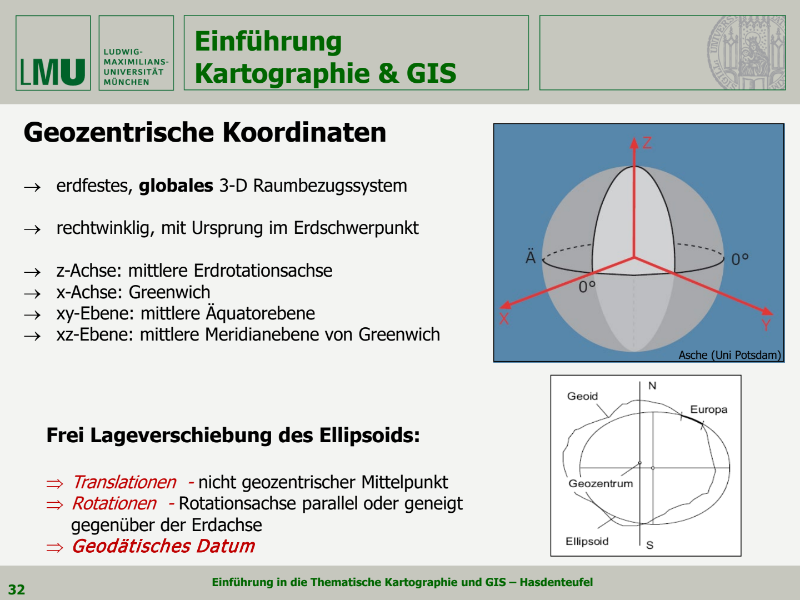
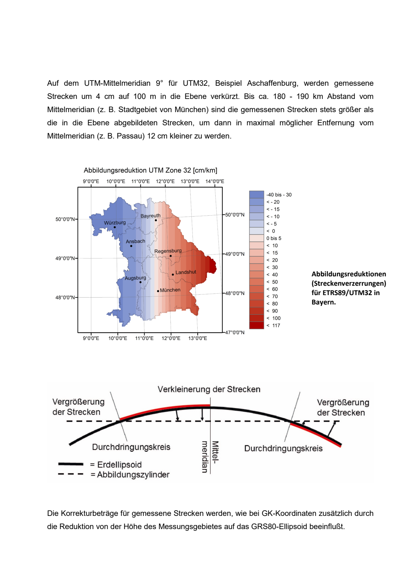
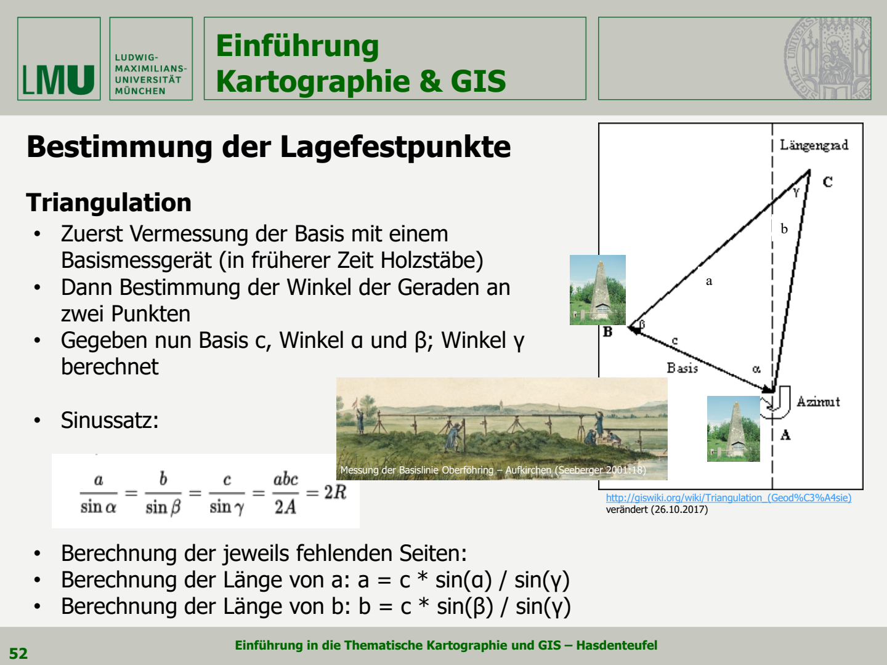
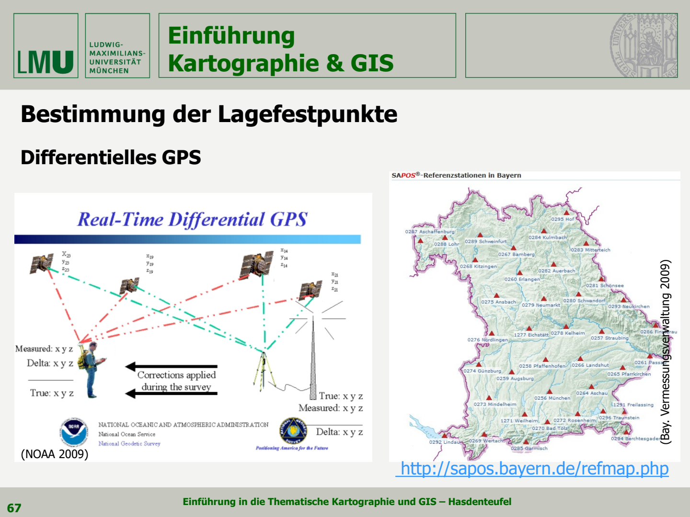
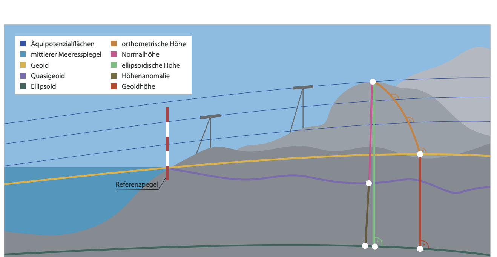
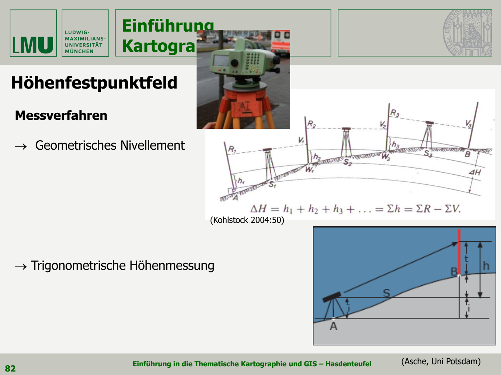

# 第三章 空间参照 参考系统与基础测量

本章解决三个问题：**用什么模型描述地球？怎样表示一个点的位置和高程？怎样通过测量获得这些数值？**

学习主线：地球模型 → 参考系统与坐标 → 控制测量和卫星定位 → 平面坐标与高程的正确使用。

依据第三讲及“教材资料/03”中的全部配套资料整理。以下均为 **PDF 页码**；补充公式和例题用于理解原理，历史配置与统计不代表当前状态。

## 资料索引

| 编号 | 资料 | 内容 |
|---|---|---|
| L | [第三讲讲义](../讲义/03_Karto_GIS_VL03_public.pdf) | 本章主线 |
| U1 | [UTM 投影与坐标](../教材资料/03/UTM%20Abbildung%20und%20Koordinaten.pdf) | 分带、坐标、报位网格 |
| U2 | [UTM 改制说明](../教材资料/03/Faltblatt_UTM-Umstellung.pdf) | GK 对比、系统改制、数据转换 |
| U3 | [UTM 投影变形](../教材资料/03/UTM_Abbildungsverzerrungen.pdf) | 长度变形与归算 |
| G | [大地水准面与重力](../教材资料/03/geoid-undulationen-schwere.pdf) | GNSS 高程与实用高程 |
| H | [国际高程参考系统 IHRS](../教材资料/03/IHRS.pdf) | 高程类型、位势数、全球高程统一 |

## 1 地球形状 从球体到旋转椭球

来源：L 第 2–7 页；视频 03.1。

### 1.1 为什么要建立地球模型

真实地表起伏复杂，不适合直接作为统一计算面，因此需要近似模型。

| 表面／模型 | 德语 | 用途 |
|---|---|---|
| 地形表面 | topographische Erdoberfläche | 实际山地、海底等表面，地物所在之处 |
| 球体 | Kugel | 简化计算，适合部分小比例尺地图 |
| 旋转椭球 | Rotationsellipsoid | 规则数学曲面，用于坐标与投影计算 |
| 大地水准面 | Geoid | 重力场定义的物理参考面，用于理解物理高程 |

**地形表面、椭球面与大地水准面不是同一个面。**

### 1.2 从日影推算地球周长

Eratosthenes 的思路：太阳光近似平行，两地日影的角度差可联系地心角。若两地近似位于同一子午线，已知弧长 $s$ 和夹角 $\Delta\varphi$，便可推算周长 $U$ 与半径 $R$：

$$
U=s\frac{360^\circ}{\Delta\varphi},\qquad R=\frac{U}{2\pi}
$$

这里的 $s$ 是与该角度对应的弧长，不能任意使用两城直线距离。
![[截屏2026-10-27 16.49.33.png]]
* 讲义给出，1672年，Richter 在巴黎将一个秒摆（周期 T 恰好为 2 秒的单摆）校准好，当他带着这台摆钟来到靠近赤道的卡宴（Cayenne）时，发现摆钟每天慢了约 2.5 分钟。根据单摆周期公式 $T = 2\pi*\frac{l}{g}$ 变形，摆长 l 不变，周期 T 变大，说明当地的重力加速度 g 变小了。说明赤道地区距离地心比高纬度（巴黎）更远。从而证实了地球不是完全规则球体
* 1670年，**Newton** 提出 **Gravitationsgesetz** 
* 1629-1695年，**Huygens** 提出 **Gesetze über Zentrifugalkraft**(关于离心力的规律)

### 1.3 旋转椭球与扁率

🌟 **Rotationsellipsoid(旋转椭球体) = mathematische Regelfläche(数学规则曲面)**
椭圆绕短轴旋转形成扁椭球: Aufwölbung am Äquator, Abplattung am Pol(赤道略鼓、两极略扁)

- $a$: große Halbachse(长半轴)，即 Äquatorialachse(赤道半径)
- $b$: kleine Halbachse(短半轴)，即 Polarachse(极半径)
- $f$：扁率 Abplattungsfaktor，表示偏离球体的程度
	- 完美球体(a = b)：f = 0

$$
f=\frac{a-b}{a},\qquad b=a(1-f)
$$

地球赤道直径约 12,756 km，极直径约 12,714 km，整体仍很接近球体。
🌟**极点附近曲率半径(Krümmungsradius)半径最大**
* **曲率半径**：曲线或曲面在某一个点上弯曲程度的量
	* **曲率半径大 = 弯曲缓；曲率半径小：弯曲急**
![[截屏2026-10-27 17.14.14.png]]
* **Meridian von Greenwich(格林威治子午线):** 即 **Prime Meridian(本初子午线)/Nullmeridian(零子午线)**，经度为0°的经线
* **Ellipsoidnormale(椭球法线):** 在旋转椭球体表面任意给定点(例如点P)上，垂直于该点切平面的直线

不同观测与拟合方法产生 Bessel、Hayford、Krassowsky、WGS84 等椭球。重点记住：**Bessel(1841) 用于德国传统测绘，GRS80 用于 ETRS89，WGS84 常见于全球卫星定位。** 椭球形状相近，不代表完整参考系统相同。

## 2 大地水准面 重力场与垂线

来源：L 第 8–13 页；G 全文；视频 03.2。

### 2.1 Geoid(大地水准面) 是什么

**Geoid = physikalisches Modell der Äquipotenzialfläche**(等势面的物理模型)
* 几何视角，可以想成延伸到大陆下方的理想化平均海水面 **(idealisierte Meeresoberfläche unter den Kontinenten)**
	* 理想化平均海水面：暂时排除掉潮汐、风暴、洋流等因素对海洋表面的干扰，只保留因地球引力决定的平均水位
	* 延伸到大陆下方：需要一个能够覆盖全球的标准参考面，而现实中海洋之只能停留在海洋盆地，所以理想化地把大陆“挖通”，形成让海洋在全球地下和海绵连成一体的封闭曲面
* 物理视角，它是具有恒定重力势的表面 **(Fläche konstanten Schwerepotenzials)**，即等势面 **(Äquipotenzialfläche)**
	* 重力势：单位质量的物体在地球重力场中所具有的势能。会被三维空间中高度、水平坐标以及周边介质密度共同影响
	* 恒定：把所有重力势相等的点全部连接，形成一个连续的曲面。这个曲面上的任意位置，重力势都是一个固定的常数

- 重力方向在每一点垂直于等位势面。
- 地球质量分布不均匀，加上自转影响，使它不是规则椭球。
- 真实海面还受风、海流和潮汐影响，不能处处等同于 Geoid。

图 1：L 第 10 页
* **Geländeoberfläche（真实地形表面）**：最上方起伏不平的实体表面
* **Geoid（大地水准面）**：有起伏的粗虚线
* **Ellipsoid（参考椭球体）**：规则的细虚线
* **Geoidundulation（大地水准面差距, N）**：指 Geoid 与 Ellipsoid 之间的垂直距离
* **Schwerelot（重力铅垂线）**：红色实线。代表真实的重力方向，**处处严格垂直于Geoid**
* **Ellipsoidnormale（椭球法线）**：蓝色虚线。代表Ellipsoid的法线
* **Lotabweichung（垂线偏差）**：Schwerelot 和 Ellipsoidnormale 的夹角 $\theta$
	* 偏差原因：Ellipsoid是一个理想的规则几何体，而真实的地球内部密度不均，导致物理重力方向与数学法线无法完美重合，而产生一个微小偏角

![[截屏2026-10-27 18.49.14.png]]
* **Ellipsoidische Höhe(椭球高, h):** 地面上某一点沿**数学参考椭球的法线**到参考椭球面之间的几何距离
* **Orthometrische Höhe(正高, H):** 地面上某一点沿真实的**重力铅垂线**从大地水准面到该点之间的实际物理距离
* 二者核心关系：**h = H + N**

### 2.2 全球与局部椭球

- **全球平均椭球 mittleres Erdellipsoid**：
	- geozentrischer Mittelpunkt und gleiche Rotationsachse wie Erdachse: 几何中心即为地球质心，旋转轴与地球自转轴完全重合
	- Ersatzfläche für das gesamte Geoid：用来近似整个地球大地水准面
	- Referenz für globale geodätische Messungen：全球性大地测量标准参考
	- nicht für nationale Landesvermessung geeignet：不适合区域精密测绘
	- z.B. IUGG 1980![[截屏2026-10-27 19.07.39.png]]
- **局部最贴合椭球 lokal bestanschließendes Ellipsoid**：
	- nicht geozentrischer Mittelpunkt：几何中心与地心有偏移
	- Rotationsachse parallel oder geneigt gegenüber der Erdachse：旋转轴与地球自转轴存在倾角
	- Referenz für Ausschnitte des Geoids：大地水准面局部区域的最佳拟合面
	- an lokale Bedürfnisse der Landesvermessung angepasst：服务于国家测绘
	- z.B. Bessel 椭球 - 为了最完美贴合德国及周边地区的局部地形而设计![[截屏2026-10-27 19.07.55.png]]

Geoid 模型需要组合**卫星重力观测与地面、航空、海洋重力观测**。GOCE、GRACE、GRACE-FO 等提供全球大尺度信息，绝对和相对重力测量补充局部细节。G 中约 100 km 的卫星分辨率、巴伐利亚约 4 km 的地面加密间距及 GCG2011 精度均是资料当时的例子。

## 3 参考系统 坐标与大地基准

来源：L 第 14–27 页；H 第 6–8 页；视频 03.3。

### 3.1 核心概念区分

* **Geodätisches Referenzsystem（大地测量参考系统）**
	* 定义: ein Satz von (vier) Parametern zur Definition einer rotationsellipsoidischen Näherung für Figur und Schwerefeld der Erde. 一组用来在数学和物理上定义一个旋转椭球的参数，以此作为近似描述地球形状和重力场的标准模型
* **Geodätische Bezugssysteme（大地测量基准系统）**
	* 定义：Koordinatensysteme zur Beschreibung der räumlichen Position, der zweidimensionalen Lage, der Höhe oder der Schwere von Punkten. 
	* 如何实现：通过地面上的**控制网(Festpunktfelder)**，即基础测绘控制点。必须依靠实际布设的测量标志来把抽象的坐标系固定在地球上
	* **Bezugssysteme**的具体分类：
		* erdfeste Bezugssysteme: zur Beschreibung der **dreidimensionalen Positionen** von Punkten
		* Lagebezugssysteme: zur Beschreibung der Lage von Punkten auf einer **zweidimensionalen Bezugsfläche(二维参考面)**
		* **eindimensionale** Höhenbezugssysteme und Schwerebezugssysteme: 用于确定海拔高度（正高）或重力场的基准

### 3.2 三种常用坐标表示

#### Geographische Koordinaten(地理坐标)
* **Breitenkreise(纬线，$\varphi$):** 
	* parallel zum Äquator (Nullbreitenkreis, 零度纬线)
	* senkrechte Ebene zur NS-Rotationsachse durch Erdmittelpunkt (所在平面垂直于南北旋转轴，并通过地球中心)
	* Äquator ist ein Großkreis, alle anderen sind parallele Kleinkreise
	* 纬度范围通常为 $[-90^\circ,90^\circ]$, **südliche Breite: neg. Werte(南纬为负)**
* **Längenkreise(经线，$\lambda$):**
	* **sind alles Großkreise**
	* schneiden Breitenkreise senkrecht 与纬线垂直相交
	* schneiden sich in den Polen 所有的经线最终都会在南北两极交融
	* 范围通常为$[-180^\circ,180^\circ]$, **westliche Länge: neg. Werte(西经为负)**
* 度分秒单位换算：$$
1^\circ=60'=3600'',\qquad D_{\mathrm{dec}}=D+\frac{M}{60}+\frac{S}{3600}
$$
	* 例如 $48^\circ08'24''=48.14^\circ$；南纬、西经对整个结果取负号
* 球体基本几何公式：
	* **周长：** $U = 2R\pi$
	* **表面积：** $A = 4R^2\pi$
* Kartographische Abbildungen(地图投影与球体近似)
	* 在处理全球或大区域地图时，为了避免椭球体复杂的数学计算，通常会把地球近似为一个规则的球体
	* einfache Rechenoperationen
	* für Karten kleinen Maßstabs (< 1:500.000)
	* 采用一个与地球体积相等的标准球体: beste Näherung mit dem Erdellipsoid **volumengleicher Kugel** (Radius von 6371 km)
![[截屏2026-10-29 12.43.06.png]]
（从地心 $M$ 出发，纬度角 $φ$ 与经度角 $λ$ 的三维空间张角关系）
#### Kartesische Koordinaten
* regionales 2-D Raumbezugssystem
* eben-rechtwinklige Flächenkoordinaten in metrischen Angaben采用平面直角坐标形式，以公制单位（米）进行测量
* 坐标轴特殊定义
	* **Abszisse(横坐标)**：对应x轴，代表 **Gitter-Nord**
	* **Ordinate(纵坐标)**：对应y轴，代表 **Ost**
* **Punktbestimmung(点定位)：**
	* 独立距离：zwei unabhängige Streckengrößen x, y
	* 垂直距离：senkrechter Abstand von Koordinatenachse 点到坐标轴垂直距离
	* 原点确定：Nullpunkt aus Festlegung der jeweiligen geodätischen Abbildung
	* 应用范围：Abbildung **kleinerer Gebiete** (Region, Land)
	* Grundlage der Landesvermessung(国家测绘)
![[截屏2026-10-29 13.11.05.png]]
（右侧图展示了平面直角坐标系在区域地图上的投影展开，划分了四个象限I-IVQuadrant，帮助理解在局部区域内如何利用米制王哥进行精确的平面定位）

#### Geozentrische Koordinaten(地心坐标系)
* 采用空间直角坐标(X, Y, Z)，其坐标原点严格位于**地球质量中心（Erdschwerpunkt）**
* 坐标轴与平面定义：
	* z-Achse: 指向平均地球自转轴（mittlere Erdrotationsachse）
	* x-Achse: 指向格林威治方向（Greenwich）
	* xy-Ebene: mittlere Äquatorebene(平均赤道面)
	* xz-Ebene: mittlere Meridianebene von Greenwich(格林威治的平均子午面)
* 椭球的自由位置平移
	* Translationen: 局部椭球的中心并非地心，两者在三维空间中存在坐标平移
	* Roatationen: 局部椭球的旋转轴与地球自转轴可能只是平行，或者存在微小倾角
	* Geodätisches Datum ：上述所有的平移量、旋转量以及尺度变化共同定义了**大地测量基准**，它决定了不同坐标系统之间如何精准转换和对齐

图 2：L 第 19 页。上图看坐标轴，下图看局部椭球相对地心的位置。

### 3.3 大地基准与七参数转换
* 定义：Das Geodätische Datum ist ein Satz von Parametern, der die Abmessungen eines Ellipsoids(椭球几何尺寸) und seinen Versatz gegenüber dem Massenschwerpunkt der Erde (Geozentrum)(相对于地心偏离状态) definiert。决定了一个椭球体在真实地球上的“落脚位置”
* 一个完整的大地基准由7个基本参数构成
	* drei Translationen(平移量)：$(Δx,Δy,Δz)$，单位：米(m)
	* drei Rotationen(旋转量)：$(r_x, r_y, r_z)$，单位：秒(s)
	* ein Maßstabsfaktor(尺度因子): 用于修正椭球大小时的微小尺度差异
* **Lokales Datum(局部基准)**
	* Ellipsoid ist gegenüber dem Massenzentrum der Erde verschoben：椭球中心**不与地心重合**，它是为了贴合某一特定区域而设计的
	* meist Benennung(命名) nach Regionsnamen
* **Geozentrisches Datum(地心基准)**
	* Mittelpunkt des Ellipsoids und Massenschwerpunkt der Erde fallen zusammen：椭球中心与地心完全重合
	* Datum trägt meist Namen des entsprechenden Ellipsoids: 以全局椭球命名, z.B. ETRS89(GRS80)
* **Helmert-Transformation/7-parameter-Transformation**
	* verzerrungsfreie Umrechnung(无畸变转换) von einem in en anderes, ebenfalls dreidimensionales System
	* 核心公式：
$$
X_T=C+μRX
$$
		* X: 原始坐标向量$[X, Y, Z]^T$ （系统A）
		* $X_T$: 变换后的目标坐标向量（系统B）
		* $C$：平移向量，包含三个坐标轴方向的平移量($c_x, c_y, c_z$)
		* $\mu$: 尺度因子(标量)
		* $R$: 旋转矩阵，由绕三个坐标轴的微小旋转角（$r_x,r_y,r_z$）组合而成![[截屏2026-10-29 14.24.36.png]]

## 4 ETRS89 与巴伐利亚改制

来源：L 第 25–27 页；U2。

- **ITRS**：国际地球参考系统；**ITRF**：它的具体实现
- **GRS80**：ETRS89 采用的参考椭球
- **UTM**：把相关椭球位置表达为平面坐标的投影体系，2020年彻底取代的旧系统GK
- **ETRS89**：欧洲地球参考系统
	- 以 1989.0 (1989年1月1日00:00)为参考历元
	- 与欧亚板块稳定部分相联系
	- 是 ITRS 的一部分，选用 GRS80 作为几何参考面
	- 以地心为原点的三维空间直角坐标系
	- 为了将三维曲面平展为二维地图，选用 UTM 系统来生成直角坐标

材料记载巴伐利亚于 2018/2019 年交替时改用 ETRS89/UTM，2019 年并行提供旧 GK 产品，2020 年初结束该过渡。涉及 UTM 32、33 带，以 32 带为标准；对应 ETRS89/UTM 32N、33N 的 EPSG 编码为 **25832、25833**。

**ETRS89/UTM 说明了参考基础和投影，并未自动指定物理高程。物理高程需要通过专门的高程基准系统来进行测定。**

## 5 UTM 投影 分带与读坐标

来源：U1；U2。为后续投影课程作准备。

### 5.1 基本性质

UTM（Universal Transverse Mercator，通用横轴墨卡托投影）采用横轴割圆柱投影，常用割圆柱示意，圆柱轴线垂直于地球自转轴

- 全球按经度每6°划分一个投影带，全球共划分 60 带，从西经 180° 经线向东编号，第1带位于 180°W 至 174°W
- **等角 winkeltreu**：保持局部角度，不表示长度和面积不变。
- 中央经线(Mittelmeridian)位于投影带中心，比例因子固定为 $k_0=0.9996$。
	- Mittelmeridian上1000m的真实地面距离，在投影纸上被缩短为999.6m
- 割线(Durchdringungskreise)：距离Mittelmeridian两侧约180km的两条割线上，长度完全无变形(比例因子$k = 1.0$)
- 标准覆盖南纬 80°至北纬 84°，极区使用 UPS。
- ETRS89/UTM 使用 GRS80；UTM 作为投影方法，也可配合其他基准。
![[截屏2026-10-29 15.34.32.png]]

### 5.2 带号与中央经线

带号为 $z$ 时，中央经线经度为：

$$
\lambda_0=(6z-183)^\circ
$$
* **注意：** 结果若为正，则经线位于东经(°E) ; 若为负，则经线位于西经(°W)

| 带号  | 常规经度范围   | 中央经线 |
| --- | -------- | ---- |
| 31  | 0°–6°E   | 3°E  |
| 32  | 6°–12°E  | 9°E  |
| 33  | 12°–18°E | 15°E |

补充：常规分带可用 $z=\lfloor(\lambda+180^\circ)/6^\circ\rfloor+1$ 求带号，其中 $\lfloor\ \rfloor$ 表示向下取整；180°东经归 60 带。边界和特殊分带需按规定处理。

**纬度带(Breitenband)** 通常宽 8°，最北 X 带宽 12°；用字母 C 至 X标识，跳过易混淆的 I、O。**32U 表示 32 投影带与 U 纬度带**，慕尼黑位于其中。注意：32U 的 U 是纬度带；32N 这类投影系统名称的 N 表示北半球。

### 5.3 东坐标与北坐标

- 假东移：强制将每带中央经线规定为 $E=500000\,\mathrm{m}$
	- 位置判定：
		- Mittelmeridian以西：$E < 500000m$
		- Mittelmeridian以东：$E > 500000m$
- 北坐标：
	- 北半球：以赤道为起点($N = 0m$)，向北递增
	- 南半球赤道赋值 $10,000,000 m$，向南递增以避免负值
- 这些是**投影平面坐标**，不等于现场实测距离。

**z.B.** U1 中 Mühldorf 桥梁示例：带区 33U，坐标为

$$
E=316500\,\mathrm{m},\qquad N=5345800\,\mathrm{m}
$$

33 带中央经线为 15°E
因 $500-316.5=183.5\,\mathrm{km}$，该点在中央经线投影线以西
北坐标距赤道投影线约 5345.8 km

### 5.4 100 km 报位网格简化表达

每带再划分 $100\,\mathrm{km}\times100\,\mathrm{km}$ 网格（Meldegitter），用两个字母标识。上述点也可写成：**33U、网格 UP、格内东坐标 16.5 km、北坐标 45.8 km**。格内坐标不是完整 UTM 坐标，必须结合带区和网格字母使用。

## 6 GK 与 UTM 变形和数据转换

来源：U2 第 2 页；U3。

### 6.1 两种体系对比

| 项目 | 资料中的传统 GK | 资料中的 ETRS89/UTM |
|---|---|---|
| 投影性质 | 横轴墨卡托、等角 | 横轴墨卡托、等角 |
| 椭球 | Bessel | GRS80 |
| 常规带宽 | 3° | 6° |
| 圆柱示意 | 切圆柱 | 割圆柱 |
| 中央经线比例因子 | 1 | 0.9996 |
| 巴伐利亚示例 | 第 4 带，中央经线 12°E | 32、33 带，中央经线 9°E、15°E |

这里比较具体测绘实施；GK 投影方法本身并不限定必须使用 Bessel。

### 6.2 怎样理解投影变形

局部长度比例因子定义为：

$$
k=\frac{d_{\mathrm{grid}}}{d_{\mathrm{ellipsoid}}}
$$

分子是投影平面长度，分母是对应椭球面长度。$k<1$ 表示缩短，$k=1$ 表示局部无长度变形，$k>1$ 表示放大。

中央经线处，$1000\times0.9996=999.6\,\mathrm{m}$，即每千米缩短 40 cm。向两侧远离中央经线，缩短逐步减小，在材料所说约 180–190 km 的位置附近变为零，再向外可能放大。

图 4：U3 第 2 页。下图看中央区域缩短、外侧放大；上图看不同地点的变形差异。

工程使用要分两步：**地面距离 → 高程归算到椭球 → 投影到平面**。所以坐标差计算的距离，不一定等于现场水平距离。局部比例因子近似不变时，投影面积约按 $k^2$ 缩放。

U3 的巴伐利亚例子提到 12 cm/100 m，U2 提到 20 cm/100 m，不能当成统一固定误差；改正取决于地点、带号、高程和精度需求。

### 6.3 GK 转 UTM 的实务

先确认源和目标的基准、投影、带号、单位与轴序，再选择符合数据精度的转换；转换后用已知点检查叠合和距离，也要更新存有坐标的属性字段。

**NTv2** 保存网格化的局部改正值，通过双线性插值求点的改正。资料分别提供 BY-KanU 用于地籍相关数据、BeTA2007 用于地形／ATKIS 相关数据。

**“指定 CRS”是说明原坐标的含义；“转换／重投影”才会计算新坐标。** 只改标签不能完成转换。

## 7 平面控制点与基础测量

来源：L 第 28–37 页；视频 03.4。

### 7.1 控制网为什么重要

控制网（Festpunktfeld）是一组已知位置的点，使不同测量可以接入同一参考系统。

- **Lagefestpunkt**：平面控制点；**Fundamentalpunkt**：传统起算点。
- **TP, Trigonometrischer Punkt**：三角点；**AP, Aufnahmepunkt**：下级测量控制点。
- **Vermarkung**：用标石等在地面固定点位。

### 7.2 三种建网方法

| 方法 | 主要观测量 | 原理 |
|---|---|---|
| Triangulation 三角测量 | 基线与角度 | 用边角关系扩展三角网 |
| Trilateration 三边测量 | 距离 | 由多条边长确定点位 |
| Polygonierung 导线测量 | 连续边长与转角／方向 | 沿折线传递坐标，并检查闭合 |
后两种方法详见 Folien03 第37页
### 7.3 三角测量怎样计算

讲义以 Oberföhring–Aufkirchen 基线为例：先测一条基线 $c$，再测两端角 $\alpha,\beta$，用正弦定理求其余边。

$$
\gamma=180^\circ-\alpha-\beta
$$

$$
\frac{a}{\sin\alpha}=\frac{b}{\sin\beta}=\frac{c}{\sin\gamma}
$$

$$
a=c\frac{\sin\alpha}{\sin\gamma},\qquad b=c\frac{\sin\beta}{\sin\gamma}
$$

图 5：L 第 32 页。边与同名角相对。以上是课堂平面三角形近似；高精度大范围建网还需归算与平差。

例如 $c=1000\,\mathrm{m}$、$\alpha=50^\circ$、$\beta=60^\circ$，则 $\gamma=70^\circ$，$a\approx815.21\,\mathrm{m}$，$b\approx921.60\,\mathrm{m}$。

### 7.4 平面控制点的建立难点和策略
* **hoher Aufwand** zur Bestimmung aller Festpunkte
* Festlegung eines Fundamentalpunktes：需要首先选定一个核心的基本点作为整个区域测量的基准起点
* Basisvergrößerungsnetz(基线放大网)：由于直接测量长距离非常困难，传统测绘采用基线放大网，通过几何三角网逐步放大一小段精准测量的基线
	* 通过Triangulation，在视野开阔的高处建立起相互通视的Trigonometrische Punkte
* 历史案例：德国主三角网(DHDN)
	* 基准点：Rauenberg in Berllin ; 参考椭球：Bessel
	* 三角点网(TP-Feld):
		* TP 1.Ordnung(一级三角点)：即DHDN网的核心骨干点
		* TP 2.Ordnung: 加密网，约每 50–100 km² 一点
		* TP 3.Ordnung: 进一步加密，约每 5 km² 一点
		* TP 4.Ordnung: 最高密度加密，约每 1 km² 一点
* Aufnahmepunkt(测图点， AP-Feld): sind die dem TP-Feld nachgeordneten Lagefestpunkte. TP网的下一级，是更具体的测图细部控制点

## 8 GNSS GPS Galileo 与差分定位

来源：L 第 38–43 页；视频 03.5。

### 8.1 卫星定位如何工作

**GNSS** 是全球卫星导航系统的总称，包括美国 GPS、欧洲 Galileo 等。其空间段发射信号，地面控制段维护轨道和时钟，用户接收机计算位置。[GPS 官方概述](https://www.gps.gov/gps)

基本思想是“传播时间乘光速得到距离”：$\rho_i\approx c\Delta t_i$。但测得的量包含时钟与传播误差，因此叫**伪距 Pseudorange**。

简化模型为：

$$
\rho_i=\lVert\mathbf X-\mathbf X_i\rVert+c\delta t+\varepsilon_i
$$

$\mathbf X$ 是接收机位置，$\mathbf X_i$ 是卫星位置，$\delta t$ 是接收机钟差，$\varepsilon_i$ 合并其他误差。常规单系统定位要求解**三个位置分量加一个钟差**，通常至少需要 **4 颗卫星**。这是距离交会原理，不是地面测角式三角测量。[FAA 原理说明](https://www.faa.gov/about/office_org/headquarters_offices/ato/service_units/techops/navservices/gnss/gps/howitworks)

### 8.2 误差与差分定位

误差来自轨道和时钟、电离层与对流层、多路径反射、遮挡、接收机噪声及卫星几何分布。讲义的“约 10 m”是历史概括，不是全部 GNSS 方法的精度上限。

图 6：L 第 41 页。已知参考站提供改正，流动站利用改正；右侧为材料当时的 SAPOS 网络。

- **DGPS**：参考站坐标已知，可估计误差，帮助附近流动站削弱共有误差。
- **RTK**：进一步利用载波相位等观测和实时改正，实现高精度定位。
- **SAPOS**：德国测绘部门的卫星定位服务，提供参考站与改正信息。
- 差分不能消除流动站附近的全部反射与遮挡误差。

### 8.3 GPS 与 Galileo

| 项目               | NAVSTAR GPS | Galileo     |
| ---------------- | ----------- | ----------- |
| 所属               | 美国          | 欧洲          |
| Satelliten(行星数)  | 24          | 30(目前26颗在轨) |
| 典型轨道高度           | 约 20,000 km | 约 23,222 km |
| Umlaufzeit(绕行周期) | 约 12 小时     | 约 14 小时     |
| 轨道面              | 6 个         | 3 个         |
### 8.4 GPS定位
* **基本原理**：Laufzeit des Signals vom Sender (Satellit) zum Empfänger (GPS auf der Erde)
* **Genauigkeit(精度)：**
	* künstliche Verfälschung der Bahndaten: 人为对卫星轨道和时钟数据进行加密货引入误差，故意降低民用定位精度
	* Verschlüsselung der Satellitensignale：对卫星信号进行加密，防止恶意干扰或伪造信号
	* SA seit Mai 2000 deaktiviert：SA功能被关闭，民用GPS精度从原先的100m大幅提升至10m左右

## 9 高程 椭球高 正高与正常高

来源：L 第 44–49 页；G；H 第 4 页；视频 03.6。

### 9.1 高程必须说明参照什么

**几何高程**参照数学曲面；**物理高程**与重力场相联系。GNSS 首先提供椭球高，设备显示“海拔”时可能已经应用模型改正。

图 7：H 第 4 页图 1。先看椭球 Ellipsoid、大地水准面 Geoid、似大地水准面 Quasigeoid 三条参考面，再看相应的高度线。

* Geoid 和 Quasigeoid 的区别：
	* Geoid 是一个真实的物理等势面，且在全球范围内与平均海平面最佳拟合。要严格计算正高，必须知道地球内部每一处的真实质量密度，会遇到无法克服的数学物理障碍
	* Quasigeoid 是为了解决 Geoid 在山区计算不可行的难题而构建的。正常高的计算不需要知道地球内部的真实密度

| 类型                     | 德语                  | 解释                               |
| ---------------------- | ------------------- | -------------------------------- |
| 椭球高 $h$                | ellipsoidische Höhe | 地面点沿椭球面法线到参考椭球面的纯几何距离(GPS直接测量得到) |
| 正高 $H^{\mathrm{orth}}$ | orthometrische Höhe | 地面点沿实际重力铅垂线到大地水准面的物理距离，即精确海拔高度   |
| 正常高 $H^{\mathrm N}$    | Normalhöhe          | 地面点到拟大地水准面的物理距离                  |

### 9.2 两组换算不能混用

入门理解正高时：

$$
h\approx H^{\mathrm{orth}}+N_g,\qquad H^{\mathrm{orth}}\approx h-N_g
$$

正常高则为：

$$
h=H^{\mathrm N}+\zeta,\qquad H^{\mathrm N}=h-\zeta
$$

$N_g$ 是 Geoid 起伏；$\zeta$ 是**高程异常 Höhenanomalie**，表示似大地水准面相对椭球的高度。Geoid 不等于 Quasigeoid，二者不能严格混用。德国 DHHN2016 正常高应采用相应的椭球高和似大地水准面模型。[BKG 换算说明](https://gibs.bkg.bund.de/geoid/gserlaeuter_g.php)

例：$h=550.00\,\mathrm m$、$\zeta=47.20\,\mathrm m$，则 $H^{\mathrm N}=502.80\,\mathrm m$。资料中“加上改正”的说法取决于改正数如何定义；按这里的定义要**减去**分离量。

### 9.3 为什么不能直接用椭球高判断水流

椭球高测量的是数学距离，参考的是一个完美的数学椭球，并不考虑地球内部的重力。而水的平衡受重力位势控制，因此按椭球高观察，水甚至可能看似“上坡”。

## 10 德国高程系统与高程测量

来源：L 第 45–49 页。

### 10.1 NN NHN 与 DHHN

**DHHN（Deutsches Haupthöhennetz）是德国主高程网，用于确定物理高程
NN（Normalnull）是历史零点名称(整个国家或地区的海拔高度必须有一个统一的人为规定的起点)
NHN（Normalhöhennull）是正常高零点(正常高的零起算基准)**

| 阶段 | 讲义要点 |
|---|---|
| 1879 | Berlin 天文台历史基准点，联系旧 NN 高程 |
| DHHN12 | NHP1912 基准点，历史 NN 体系 |
| DHHN85 | 后续发展阶段 |
| DHHN92 | 统一的正常高参考，使用 NHN |
| DHHN2016 | 重新测量一级水准网，加强几何与物理参照的联系 |

讲义记载巴伐利亚于 2017 年 6 月 30 日引入综合空间参照 2016；DHHN2016 状态码为 170，旧 DHHN12 为 100，DHHN92 为 160。与旧系统可有厘米级差异，如材料所述相对 DHHN12 约 ±6 cm 的区域差异，但不是所有点统一加减的常数。

工程中应写明“DHHN2016 中高于 NHN 的正常高”，新旧系统之间需要转换，不能只改名称。

### 10.2 高程控制点网

- **HFP, Höhenfestpunkt**：高程控制点；**NivP, Nivellementspunkt**：水准点, 高程测量点。地面上专门用来标定精准海拔高度的官方固定标记点，是全国海拔高度的基准。
- **SFP, Schwerefestpunkt**：重力基准点。精确测量该点重力大小的点
- **Messschleife**：测量闭合环。水准测量必须从一个点出发，绕一圈最后闭合回原点，这样可以通过起点终点是否对得上来发现和消除误差
	- 讲义以一级周长约 30–60 km、二级约 15–20 km、三级最大约 10 km 的环说明层次

历史统计：DHHN92 有 757 条 Nivellementslinien(水准线)、30,908 km Gesamtlänge(总长)、287 个 Schleifen(环) 及 469 个 Knotenpunkten(结点)

### 10.3 几何水准与三角高程

**几何水准 geometrisches Nivellement：** 仪器提供水平视线，读取后视 $r$ 和前视 $v$，后视减前视得到高差。

$$
\Delta H_{AB}=R-V,\qquad H_B=H_A+R-V
$$

多个测站累计：$\Delta H=\sum R-\sum V$。精密物理高程网还需重力改正与平差。

**三角高程 trigonometrische Höhenmessung：** 用距离和仰角求高差，再计入仪器高与目标高。简化公式为：

$$
\Delta H\approx d\tan\alpha+i-t
$$

$d$ 为水平距离，$\alpha$ 为仰角，$i$ 为仪器高，$t$ 为目标高。若观测的是天顶距，要换用对应公式；远距离还需考虑曲率与折光。

图 8：L 第 49 页。上图用水平视线与标尺读数，下图用距离与角度。

## 11 全球高程统一 IHRS 与 IHRF

来源：L 第 50–52 页；H 第 4–9 页。

### 11.1 为什么各国高程不能直接拼接

国家系统常联系某个验潮站的平均海平面，但不同地点、时期的海面及系统实现不同，零点可能有分米级差异。讲义以 Brenner 隧道说明：德国、奥地利、意大利采用不同高程参照，跨国工程必须统一，不能把某个案例的厘米差异当成通用改正常数。

### 11.2 IHRS 的物理基础

**IHRS（International Height Reference System，国际高程参考系统）** 于 2015 年由 IAG 采用。它规定**全球统一的重力位势基准** $W_0$，不要求真实海面处处相同。

点 $P$ 的位势数 geopotenzielle Kote 为：

$$
C_P=W_0-W_P
$$

$W_P$ 是**该点的重力位势**，$C_P$ 的单位是 $\mathrm{m^2/s^2}$。除以适当重力值，才得到米制高程：

$$
H\sim\frac{C}{g_*}
$$

正高使用适当平均真实重力，正常高使用相应平均正常重力，动力高使用约定参考重力。等位势面不平行，原始水准高差直接累加可能具有路径依赖，因此要结合重力转成位势差，再求物理高程。

IHRS 将 **ITRS 中的几何位置 $(X,Y,Z)$** 与**该点重力位势 $W_P$**联系起来：既要知道点在哪里，也要知道该处重力场，所以 GNSS 不能替代重力观测。

### 11.3 IHRF 怎样实现 IHRS

**IHRF（International Height Reference Frame，国际高程参考框架）**通过以下要素实现定义：

1. 全球核心参考站与区域、国家加密网。
2. 统一标准、计算方法及参考坐标成果。
3. 数据、分析与产品中心等长期维护设施。

站点需考虑连续 GNSS、与综合观测站和重力站共址、连接验潮站与国家水准网，并具备周边重力资料。卫星观测提供全球长波参考，地面、航空与海洋观测补充局部细节。

H 所列约 170 站、完成约 45%、卫星约 100 km 分辨率等属于 2021 年文章背景；精度目标也不等于全球已经达到的精度。

应用包括跨国桥隧、洪水和海平面研究、冰体变化、沉降与地壳运动。系统需要持续更新站网、模型、时间变化与转换元数据。**全球高程框架与精密地方水准网互相补充。**

## 12 易错点集中辨析

| 容易混淆 | 正确理解 |
|---|---|
| 地表、椭球与 Geoid | 实际表面、数学模型与物理参考面 |
| 垂线偏差与 Geoid 起伏 | 前者是角度，后者是长度 |
| 椭球高、正高与正常高 | 参照面与定义不同，不能直接混用 |
| ETRS89 与 UTM | 前者是参考系统，后者是投影 |
| GRS80 与 WGS84 近似相同 | 不代表参考实现与历元也相同 |
| UTM 等角 | 不表示等距或等面积 |
| $E=500000\,\mathrm m$ | 指所在带中央经线，而非 Greenwich |
| 32U 与 32N | U 是纬度带；投影系统名中的 N 是北半球 |
| 指定 CRS 与坐标转换 | 改标签不同于重新计算坐标 |
| GPS 的三颗卫星 | 常规三维定位还要求钟差，通常至少四颗 |
| IHRS 统一海拔 | 统一物理参考，不是统一使用一个地方验潮站 |

## 13 计算练习与单位

以下练习用于检查是否理解公式。计算前先确认角度、长度单位和参考面。

1. 子午线弧长 800 km、地心角 7.2°，求地球周长。  
   $U=800\times360/7.2=40000\,\mathrm{km}$。
2. $a=6378\,\mathrm{km}$、$b=6357\,\mathrm{km}$，求扁率。  
   $f=(6378-6357)/6378\approx0.003293$，倒数约 303.7；这是教学近似。
3. 求 UTM 33 带中央经线。  
   $\lambda_0=(6\times33-183)^\circ=15^\circ\mathrm E$。
4. 只考虑中央经线投影比例，椭球面 500 m 对应多少平面距离？  
   $d_{\mathrm{grid}}=500\times0.9996=499.8\,\mathrm m$；不含高程归算。
5. $h=550.00\,\mathrm m$、$\zeta=47.20\,\mathrm m$，求正常高。  
   $H^{\mathrm N}=550.00-47.20=502.80\,\mathrm m$。
6. 已知点高程 100.000 m，后视 1.432 m、前视 0.876 m，求下一点高程。  
   $H_B=100.000+1.432-0.876=100.556\,\mathrm m$。

球体基础：$U=2\pi R$，$A=4\pi R^2$，$V=4\pi R^3/3$。

单位换算：$1\,\mathrm{km}=1000\,\mathrm m$，$1\,\mathrm{cm}=0.01\,\mathrm m$，$1\,\mathrm{mm}=0.001\,\mathrm m$；$1\,\mathrm{gon}=0.9^\circ$，$1\,\mathrm{rad}=180^\circ/\pi$。
