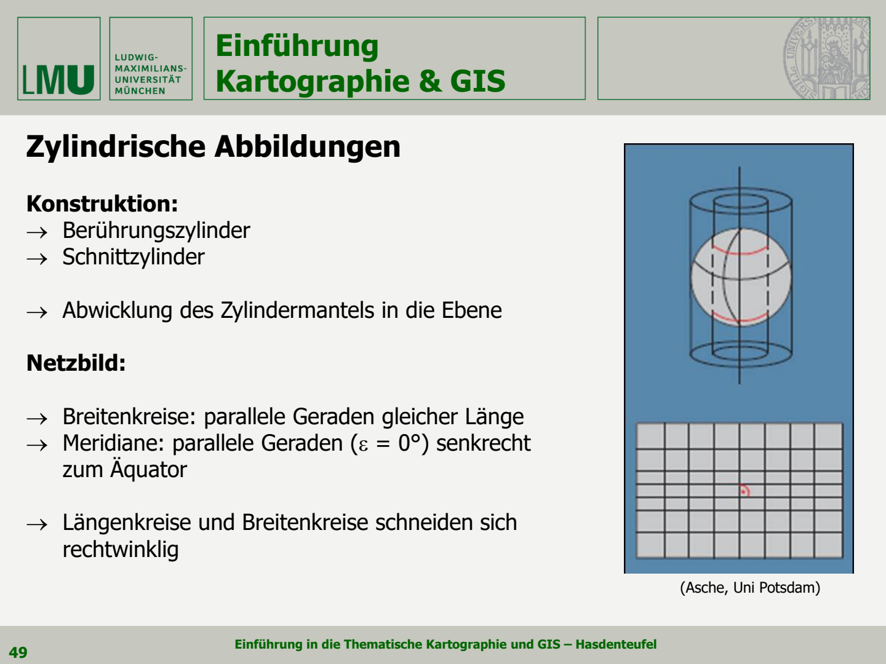
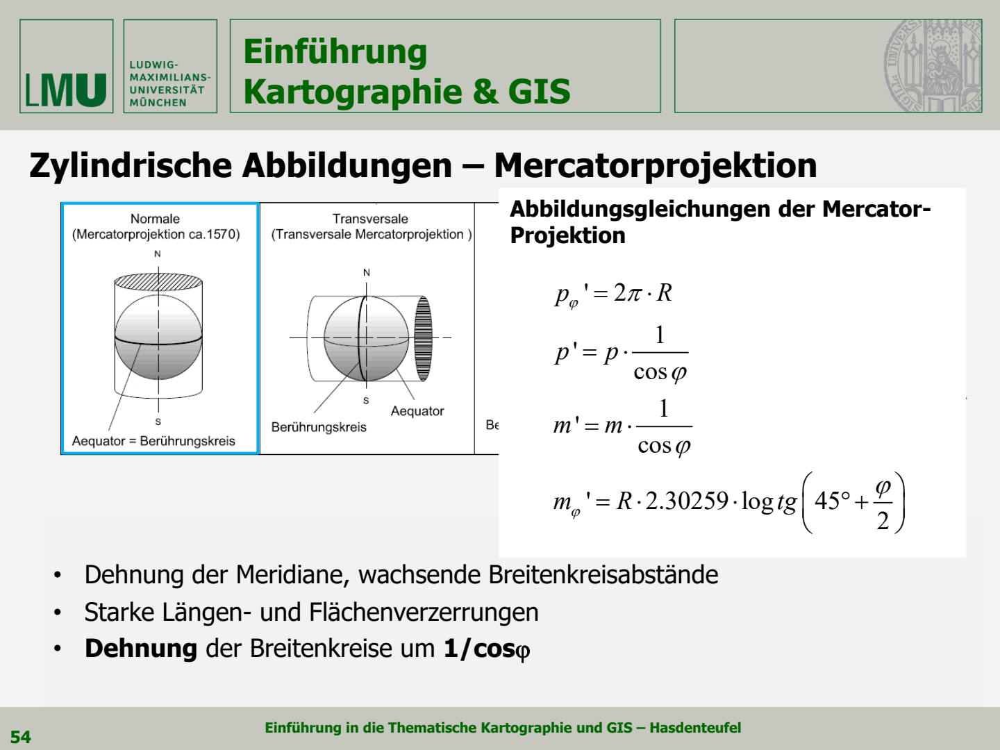
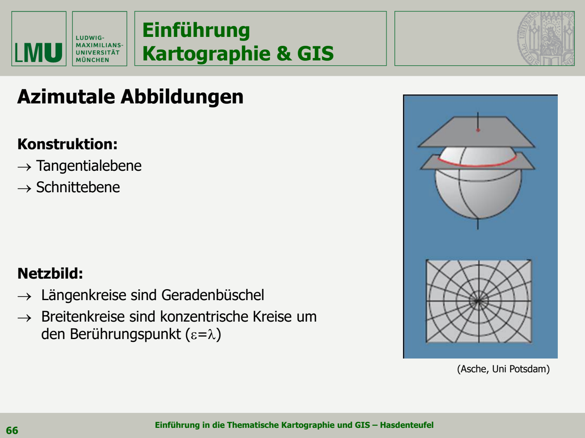
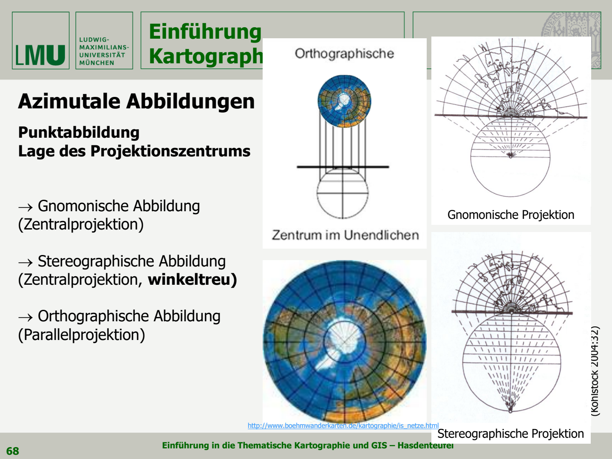

本章回答三个问题：**怎样把弯曲的地球表面画到平面上？投影会改变什么？怎样根据用途选择投影？**

学习主线：投影的定义与分类 → 长度、面积和角度变形 → 圆锥、圆柱、方位投影 → 航线与世界地图的选择。

来源：[第四讲讲义](../讲义/04_Karto_GIS_VL04_public.pdf)。公式按球面模型解释；标为“补充理解”的内容帮助读图和计算，不代替后续椭球投影公式。

## 一. 地图投影是什么

视频 04.1。

### 1.1 定义

第三章先确定地球模型及其定位：椭球、Geoid、大地基准；本章讨论怎样把参考曲面上的点转到地图平面。

**Kartennetzentwürf / Kartenabbildung / Kartenprojektion(地图投影)**  
bilden die **Netzlinien und Punkte** eines Koordinatensystems von der mathematisch definierten Oberfläche eines Weltkörpers (**Urbild**) so in die Ebene (**Abbild**) ab, dass dort eine geeignete geometrische Grundlage für kartographische Modelle und kartographische Darstellungen entsteht. 
它通过数学规则，将球面或椭球面上的坐标网与点映射到平面，为地图提供几何基础。

- **Urbild，原像**：球面／椭球面上的位置与网线。
- **Abbild，像**：投影平面中的位置与网线。
- **Abbildungsgleichung，投影方程**：把经纬度转换为平面坐标的计算规则。

一般可写为：

$$
x=f(\varphi,\lambda),\qquad y=g(\varphi,\lambda)
$$

这里 $\varphi$ 是纬度、$\lambda$ 是经度；$x,y$ 的方向由具体公式约定。**投影既可用几何图解释，也可由数学公式构造。**

### 1.2 方法与模型选择
* 区分**真/非真投影**：regelbasierte Abbildung (Arithmetik) bzw. Projektion (Geometrie) von Netzlinien- und Punktsystemen
	* **echte Abbildungen:** 可以用圆柱、圆锥或平面解释其构造。正轴情况下，网线具有规则结构，例如圆柱展开后，经纬线是互相垂直的直线。
	* **unechte Abbildungen:** 通过其他数学构造、修改或组合这些网形。例如，为了让世界地图整体看起来更均衡，将部分经线设计成曲线。
* 投影计算使用模型(测绘越精细，对模型和坐标系要求越高)：
	* **比例尺为 1∶2,000,000 及更大时**：以 **Rotationsellipsoid**(旋转椭球体) 为基础
	* **比例尺更小时**：将地球近似为球体，取半径 $R=6371\mathrm{km}$
	* **国家基础测绘**: lokale Koordinatensysteme (ab dem 18. Jh.) -> geodätische Abbildungen/Netze 

### 1.3 投影选择的五个依据

- **darzustellende Information(表达的信息)**：比较面积、规划路线，还是展示空间分布？
- **Zielgruppe(目标读者)**：专业测量、导航人员，还是一般读者？
- **Größe, Lage und Maßstab des Kartenausschnitts**：赤道、极区、中纬度区域需求不同。
- **Vorgabe von Verzerrungs- und Geometrieeigenschaften(允许的变形与图面形态)**：优先等积、等角，还是整体均衡？
- **Einbindung in bestehende Dokumente oder Daten (已有资料与系统要求)**：是否需要衔接既有地图、坐标系统和数据？

## 二. 投影的五个分类角度

分类角度可以组合，例如“正轴＋等角＋圆柱”描述的是同一个投影的三个方面。

### 2.1 按地理坐标网参数(Parametern des Kartennetzes)

|      | Global                                                        | Regional                                                |
| ---- | ------------------------------------------------------------- | ------------------------------------------------------- |
| 投影类别 | geographische Abbildung / Gradnetzentwurf(地理投影／经纬网投影)         | Geodätische Abbildungen(大地测量投影)                         |
| 比例尺  | kleine bis mittlere Maßstäbe (M ≤ 500.000)                    | mittlere bis große Maßstäbe (M ≥ 500.000)               |
| 参考模型 | Kugel                                                         | Ellipsoid, 通常指 lokale Ellipsoid                         |
| 定位基础 | geographisches Kartennetz(经纬网) / geographische Koordinaten    | Kartengitter mit geodätischen/ kartesischen Koordinaten |
| 图上网格 | je nach Abbildungsformel unterschiedliche Abbilder 随投影公式不同而变化 | stets **quadratische** Gitterstruktur                   |
| 主要用途 | 表达全球或大范围地理信息                                                  | 便于 Messung, Berechnung, Kartierung, Auswertung          |
* 大范围地图侧重地理分布的表达；区域测绘更需要便于精确量测的米制平面坐标网。同一张地图也可以同时画出经纬网和米制格网。

### 2.2 按投影面类型(Art der Abbildungsfläche)

* **echte Abbildungen（真投影／规则投影）**：规则网形
* 网形特点：
	* Meridiane treffen sich als Geraden in einem Punkt：**经线映成直线，并汇聚于同一点**；这个交点也可能位于无穷远，即经线相互平行
	* Breitenkreise bilden konzentrische Kreise um diesen Punkt：**纬线映成围绕该点的同心圆**；在圆柱这种极限情形下，纬线表现为平行直线
	* Alle Linien schneiden sich rechtwinklig：经线与纬线互相垂直

| 类型 | 德语 | 正轴时的典型网形 |
|---|---|---|
| 圆锥投影 | konische Abbildung | 经线汇聚，纬线为同心圆弧 |
| 圆柱投影 | zylindrische Abbildung | 经线、纬线均为互相垂直的平行直线组 |
| 方位投影 | azimutale Abbildung | 极地方位图中，经线放射、纬线为同心圆 |

图 1：上方看投影面，下方看展开后的网形。圆柱可理解为圆锥顶点移到无穷远、平面可理解为圆锥的另一极限情形。

* **Unechte Abbildungen(非真投影)** -> **“Nicht-kegelige" Abbildungen(非圆锥投影)**: 放宽规则网形，通过数学修改或组合，获得适合特定表达目的的地图
* 网形特点：
	* Verzicht auf Rechtwinkligkeit zwischen λ und ϕ：放宽经度线和纬度线之间的直角关系，也就是说不再要求经纬线处处相交
	* Forderung nach Netzsymmetrie besteht weiter (Verzerrungen!)：仍保留坐标网的对称性要求，同时需要考虑投影变形
	* Planisphären(平面世界图), Planigloben(半球图), Transformationen zwischen Karten, Anamorphosen(变形地图)
![[截屏2026-11-04 14.26.04.png]]
* Winkel(混合投影)：将等距圆柱投影与 Aitoff 非真方位投影结合，得到适合展示世界整体的网形
* Katogramm/Kartographische Anamorphose(地图变形图)：按照人口等专题数值改变地区的图面大小，而非保持实际地理面积

### 2.3 按投影面的轴向(Lage der Abbildungsfläche)

| 轴向  | 德语                       | 初学者理解                        |
| --- | ------------------------ | ---------------------------- |
| 正轴  | normal / polständig      | 投影轴与地球自转轴一致；圆柱常围绕赤道，方位面常切于极点 |
| 横轴  | transversal / querachsig | 投影轴与自转轴垂直；可把投影面“转过 90°”理解    |
| 斜轴  | schiefachsig             | 投影轴与自转轴成其他角度                 |

图 2：按列比较轴向，按图中字母区分圆锥(K)、平面(A)与圆柱(Z)。**变换轴向可以把较小变形区域移到目标地区附近。**

### 2.4 按透视投影的视点(Lage der Projektionszentrums)

| 名称                                       | 视点位置      | 重要特点             |
| ---------------------------------------- | --------- | ---------------- |
| Gnomonische Projektion(心射投影)             | 球心        | 球面大圆映成直线         |
| Stereographische Projektion(球面立体／球极平面投影) | 切点的对跖点    | 等角；视点并非球心        |
| Orthographische Projektion(正射投影)         | 无穷远，投影线平行 | 类似从远处看地球；不是等积或等角 |
**切点／图面中心**是要表现的中心位置；**透视视点**是投影线出发处。
* **Abbildungsvorschrift(映射法则)：**
![[截屏2026-11-04 14.53.58.png]]

### 2.5 按保持的几何性质(Abbildungseigenschaften)

把地球画到平面上以后，哪些几何关系还能保持？

- **Längentreue / Äquidistanz：等距**，指定的某些距离保持正确，但不是任意距离
- **Flächentreue / Äquivalenz：等积**，保持面积比例
- **Winkeltreue / Konformität：等角／保角**，保持局部夹角
- **vermittelnde Abbildung：折中投影**，不严格保持以上某一项，尽量让变形较均衡
- **全部满足 -> Abbildung kongruent(全等映射)**, 即相当于没有几何变形。只是一个假设，毕竟地球曲面不能这样完整铺平，所以做地图必须取舍。
![[截屏2026-11-04 15.15.37.png]]
* 纬线圆周保证，经线弧长会被缩短；经线方向长度保证，纬圆周会被拉长。所以不能做到把整个地球摊平，还处处距离正确
![[截屏2026-11-04 15.18.20.png]]
* 等距：南北方向保持，东西方向被拉长
* 等积：面积保持，但变扁
* 等角：夹角保持，面变成原来4倍

## 三. 变形与 Tissot 指示椭圆

视频 04.2。

### 3.1 长度比例因子

讲义用以下公式表示 **Längenverzerrung（长度变形）**：

$$
\rho=\frac{s'}{s}
$$

$s$ 为原曲面长度，$s'$ 为投影后的对应长度。

- $\rho=1$：该点该方向无长度变形
- $\rho>1$：拉伸；$\rho<1$：压缩

长度变形还有三个特点：

- **随地点变化**（von Punkt zu Punkt verschieden）：不同位置的拉伸程度可能不同。例如 Mercator 投影中，同样长的小线段在高纬度通常比在赤道附近放大更多。
- **随方向变化**（von Richtung $\alpha$ abhängig）：同一地点，南北和东西方向可能按不同的比例伸缩，因此小圆会变成椭圆。等角投影是特殊情况：同一点各方向同比例缩放，小圆仍是圆。
- **方向角也可能改变**：原线段方向角为 $\alpha$，投影后为 $\alpha'$；若各方向伸缩不同，斜线的方向可能随之改变，即 $\alpha'\ne\alpha$。这里比较的是原像与投影图中相应参考方向下的角度。

**理解重点：不仅要问“在哪里放大多少”，还要问“沿哪个方向放大多少”。**

### 3.2 一个小圆怎样变成椭圆

**Tissot’sche Indikatrix（Tissot 指示椭圆／变形椭圆）**：在地球表面画一个极小圆，投影后一般成为椭圆，用其形状、大小和方向表示局部变形。

讲义用半径为 1° 的圆作示意；严格的指示椭圆描述的是极小范围，不能把任意大圆形区域都当成只会变成椭圆。
* 某个方向拉的多，另一个方向拉的少，小圆就会变成椭圆
* 椭圆两个半轴(Halbmessern)记为 a, b，对应两个主变形方向(Hauptverzerrungsrichtungen)
* 这两个方向在原图上互相垂直，投影后仍然互相垂直

图 3：观察圆变成椭圆后哪一方向拉长、哪一方向压缩；椭圆方向也提供信息。

| 符号               | 德语／含义                                                  |
| ---------------- | ------------------------------------------------------ |
| $h=\rho_\varphi$ | Längenverzerrung in Richtung des (Netz-)Meridians      |
| $k=\rho_\lambda$ | Längenverzerrung in Richtung des (Netz-)Breitenkreises |
| $a=\rho_{\max}$  | größter Wert der Längenverzerrung                      |
| $b=\rho_{\min}$  | kleinster Wert der Längenverzerrung                    |
| $\omega$         | 讲义使用的方向变形量 Richtungsverzerrung                         |
| $\Phi$           | 面积比例因子 Flächenverzerrung                               |

**符号提醒：** 本章的 $a,b$ 是变形椭圆半轴，不是第三章地球椭球半轴；$h$ 是长度比例因子，不是椭球高。

### 3.3 三种保持性质怎样判断

| 性质                  | 条件            | 观察椭圆时看什么               |
| ------------------- | ------------- | ---------------------- |
| winkeltreu          | $a=b$         | 小圆仍是圆，但不同位置的圆可大小不同     |
| flächentreu         | $ab=1$        | 椭圆与原单位圆面积相同，可一边拉长、一边压扁 |
| partiell längentreu | $a=1$ 或 $b=1$ | 至少一个主方向长度不变；不代表任意两点等距  |
| 局部无变形               | $a=b=1$       | 该点各方向长度与角度均保持          |

面积比例因子：

$$
\Phi=\frac{\mathrm dA'}{\mathrm dA}=ab
$$

若投影后的经纬网也正交，可写成 $\Phi=hk$；非正交网不能直接把两方向长度因子相乘。

因此：**等角不等于等积，等积也不等于形状不变。** 等角保持的是无穷小局部形状，大洲整体外形仍可能明显变形。

### 3.4 方向变形公式

按图中的轴向约定，局部坐标满足 $y'=ay$、$x'=bx$，故：

$$
\frac{\tan\alpha'}{\tan\alpha}=\frac{a}{b},\qquad
\sin\omega=\frac{a-b}{a+b}
$$

Der Maximalwert $\omega$ der Richtungsverzerrung $(\alpha' - \alpha)$ ergibt sich bei $sin(\alpha'+\alpha)=1$

## 四. 圆锥投影 Konische Abbildungen

视频 04.3。

### 4.1 构造与网形

将圆锥套在地球上，再展开锥面：

- **Berührungskegel，切圆锥**：圆锥面与地球椭球体**外切**于一条特定的标准纬线 $\varphi_0$
- **Schnittkegel，割圆锥**：圆锥面“切入”地球椭球体内部，因此圆锥面与地球表面在**两条不同的标准纬线** $\varphi_1,\varphi_2$
- 标准纬线 Standardparallel／Berührungsbreitenkreis：按所用投影规定沿线长度比例为 1 的纬线。
![[截屏2026-11-04 16.50.25.png]]
**Netzbild:**
* Längenkreise als Geradenbüschel: 经线呈放射状直线束
* Breitenkreise als konzentrische Kreisbogensegmente: 纬线呈同心圆弧段
* Berührungsbreitenkreis ($\varphi_0$ bzw. $\varphi_{01}$ und$\varphi_{02}$ ) längentreu: 切纬圈保持长度不变
* Pol als Punkt

**特点：**
* fast nur in normaler Lage：圆锥投影几乎都采用正轴位置
* Projektionszentrum Erdmittelpunkt：几何构造以地心作为投影视点
* Winkel $α$ zwischen den Meridianen im verebneten Kegelmantel abhängig von $\varphi_0$：展开后，两条经线之间的夹角取决于标准纬线 $\varphi_0$
![[截屏2026-11-04 17.12.30.png]]
* $m=R⋅tanδ$: 从扇形顶角开始，拿直尺往下量多长能找到这条纬线
* $\alpha = cosδ ⋅ λ$: 因为把圆锥展开成扇形后，原来的 360∘ 被“缩水”了（不再是整圆），所以真实的经度 λλ 乘上一个系数 cos⁡δ0cosδ0​，就变成了纸上量角器量出来的扇形偏转角 α

### 4.2 三种圆锥投影与变形

| 类型 | 德语 | 判断要点 |
|---|---|---|
| 等距圆锥 | mittabstandstreu / abstandstreu | 沿经线方向比例不变，常见 $h=1$ |
| 等积圆锥 | flächentreu | 面积比例 $\Phi=hk=1$，两方向伸缩互相补偿 |
| 等角圆锥 | winkeltreu / konform | $h=k$，方向变形为零 |

讲义图例包括等积圆锥、Ptolemäus 等距圆锥和 Lambert 等角圆锥，部分示例标准纬线为北纬 45°。**“圆锥”只说投影家族，具体保持什么还要看后半个名称。**
![[截屏2026-11-04 17.42.15.png]]
* **Flächentreu:**  地图上的陆地面积比例是绝对准确的。越往两极走（往圆心靠），纬线被越压越紧；越往南极（边缘）走，纬线被拉得越开。
![[截屏2026-11-04 17.43.33.png]]
* **Abstandstreu:** 经线方向上的距离比例是固定的。两条红线之间的间距从上到下**完全是一模一样宽的**。纬线均匀分布，看起来非常整齐。
![[截屏2026-11-04 17.44.11.png]]
* **Winkeltreu:** 局部形状和航向角度完全准确。**越往两极（圆心），纬线间距越密；越往边缘，纬线间距被急剧拉大**

图 4：标准纬线为北纬 35°、65°。从左到右为等距、等积、等角。
* 图(a) mittelabstandstreu：经线方向永远无变形(h=1 保持一条水平直线)
* 图(b) flächentreu: 面积永远无变形($\varphi=1$ 保持一条水平直线)
* 图(c) winkeltreu/konform: 角度永远无变形(w=0 保持在最底部)。同时 h 和 k 始终重合，说明各个方向拉伸比例一致

圆锥投影常用于中纬度、东西向较长区域。不是因为圆锥天然无变形，而是其标准纬线容易贴合这样的地区。

### 4.3 多圆锥思路

**Polykonische Abbildungen，多圆锥映射**：不同纬度带或图幅行采用不同圆锥，使每一行更适合本地纬度。

以 IWK 1∶1,000,000、每行纬差 $\Delta\varphi=4^\circ$ 示意。重点是**分区改善局部变形**；不同圆锥的图幅展开后可能不能无缝铺成同一平面。这里是讲义的分幅构造说明，不应理解为所有多圆锥投影都等角。
![[截屏2026-11-04 17.52.02.png]]

## 五. 圆柱投影 Zylindrische Abbildungen

视频 04.4。

### 5.1 构造与网形

**Konstruktion（构造）：**

- **Berührungszylinder（切圆柱）**：圆柱与球面相切，正轴时通常沿赤道接触。
- **Schnittzylinder（割圆柱）**：圆柱与球面相交，正轴时通常形成两条交线。
- **Abwicklung（展开）**：将圆柱侧面剪开展成平面。

**Netzbild（网形），以下指正轴情况：**

- **Breitenkreise**：parallele Geraden gleicher länge
- **Meridiane**：parallele Geraden senkrecht zum Äquator，彼此不汇聚，故经线夹角 $\varepsilon=0^\circ$
- 经纬线 **schneiden sich rechtwinklig**：相交成直角

* 给地球套上圆筒，再把圆筒剪开，得到横平竖直的地图网格。

### 5.2 为什么越往高纬越容易拉伸

讲义要点：图中视点位于球心；从赤道向南北两侧，变形逐渐增大；**Meridianabstände werden gedehnt（经线间距被拉大）**

**解释：** 球面上的纬线越靠近两极越短，相邻经线之间也越近；但图上所有纬线都画成同样宽，经线间距也不随纬度缩小，所以高纬地区的东西方向被拉长。

例如，北纬 60°的纬线周长只有赤道的一半，却被画成同样宽，东西方向便放大了 2 倍。这里先理解正轴切圆柱；后面不同投影会用不同办法安排南北方向的伸缩。

图中的球心射线是几何示意，**不是说所有圆柱投影都从球心直接投射**。

### 5.3 三种性质与变形曲线

比较三种圆柱投影：等积（a）、等距（b）、等角（c）。三者经纬网都能正交，区别在于**纬线间隔怎样安排，以及保持哪种性质**。

**用曲线说明它们**。先认符号：$h$ 为经线方向比例因子，$k$ 为纬线方向比例因子，$\Phi$ 为面积比例因子，$\omega$ 为方向变形。

| 位置  | 类型                  | 重点看哪条线              | 解释                 |
| --- | ------------------- | ------------------- | ------------------ |
| 左列  | mittabstandstreu 等距 | $h=1$               | 南北方向长度保持，东西方向可被拉长  |
| 中列  | flächentreu 等积      | $\Phi=1$            | 东西拉长，就在南北压缩，面积抵消回来 |
| 右列  | konform 等角          | $h=k$，下方 $\omega=0$ | 两方向同比例伸缩，局部夹角保持    |

读图时：上排比例因子等于 **1** 才表示对应的量不变；下排方向变形等于 **0** 才表示没有方向变形。实线以赤道为标准纬线；左、中列虚线另示南北纬 45°为标准纬线的情形。

### 5.4 Mercator 投影与讲义公式

Mercator 即 Gerhard Kremer（1512–1594），1569 年提出用于世界图的投影。

讲义列出三个特点：

- **Dehnung der Meridiane**：经线方向也被拉伸。
- **wachsende Breitenkreisabstände**：越往高纬，纬线间隔越大。
- **starke Längen- und Flächenverzerrungen**：高纬长度和面积变形强。

**解释：** 东西方向已经被拉长，为了保持局部角度，南北也按同样比例拉长。因此小圆仍是圆，但越来越大。

$R$ 为球半径，$\varphi$ 为纬度，撇号表示投影后的量。

| 讲义公式 | 表达的意思 |
|---|---|
| $p'_\varphi=2\pi R$ | 各纬线投到完整展开图后，与赤道同长 |
| $p'=p\dfrac{1}{\cos\varphi}$ | 东西方向的局部长度按 $1/\cos\varphi$ 放大 |
| $m'=m\dfrac{1}{\cos\varphi}$ | 南北方向的局部长度也按相同比例放大 |

从赤道到某纬度的**图上经线有符号长度**为：

$$
m'_\varphi=R\cdot2.30259\cdot\log_{10}\tan\left(45^\circ+\frac{\varphi}{2}\right)
$$

讲义的 $\mathrm{tg}$ 就是 $\tan$；这里 $\varphi$ 以度表示。$m'$ 指局部短线段，而 $m'_\varphi$ 表示从赤道累计的位置，不要混淆。

**理解例子：** 北纬 60°时，$1/\cos60^\circ=2$，两方向长度都放大 2 倍，局部面积便放大 4 倍。等角不等于等积，也不等于没有变形。

### 5.5 割圆柱与导航用途

- 使用割圆柱可以让变形分布更合理，与前面割圆锥的思路相似；Mercator 用于Navigation(Luft-, Seefahrt)
- 用 *The True Size* 演示 Mercator 的面积误导：同一地区移到不同纬度，图面大小会变化。

**解释：** 割圆柱是重新安排哪里压缩、哪里拉伸，并没有消除变形。Mercator 方便导航，是因为等角航线能画成直线。

### 5.6 其他圆柱投影例子

| 名称                                                             | 看图时记住什么                      |
| -------------------------------------------------------------- | ---------------------------- |
| querachsiger winkeltreuer Zylinderentwurf，横轴等角圆柱；例：Gauß-Krüger | 将圆柱转为横轴，地理经纬网不再是普通正轴图的横平竖直形态 |
| Lambert flächentreue Zylinderprojektion，Lambert 等积圆柱           | 保持面积比例，高纬图形可能被压扁             |
| Quadratische Plattkarte，方格投影／等距圆柱                              | 纬线等间距，沿经线方向等距；不是任意两点等距       |

**本节要分清：** “圆柱”说构造家族，“正轴／横轴”说轴向，“等积／等距／等角”说保持的性质。

## 六. 球面上的线 Orthodrome 与 Loxodrome

### 6.1 大圆 小圆与最短路线

- **Großkreis（大圆）**：圆所在平面通过球心，例如**赤道、完整经线圈**。单条经线通常是半个大圆。
- **Kleinkreis（小圆）**：圆所在平面不通过球心，例如**除赤道外的纬线**。
- 球面两点之间的最短路线，是连接它们的**较短大圆弧**，称为 **Orthodrome**。

**Loxodrome**：始终以相同夹角穿过经线的曲线。
### 6.2 Loxodrome 等角航线

- jede Kurve, die im Verlauf auf der kugel alle Meridiane in **konstantem Winkel(Azimut)** schneidet: 与所有经过的经线保持**恒定夹角**
- 别名：Schieflaufende、Kursgleiche、Winkelgleiche；英语 **rhumb line**。
- 在普通 Mercator 图上表现为直线，因此方便导航

**解释：** 始终保持**同一个地理航向**(z.B.东北45∘)走，容易执行，但通常不是最短路线。

### 6.3 Orthodrome 大圆航线

- **Auf der Kugel** bilden Orthodrome als **Segment eines Großkreises** immer die kürzeste Verbindungslinie zwischen zwei Punkten：是球面上连接两点的最短大圆弧，即球面测地线 **Geodäte / geodesic**。
- 别名 **Geradlaufende**
- schneidet Meridiane immer mit **anderem Winkel**(Azimut): 一般以不断变化的角度穿过经线，即航向通常需要调整。
- 只在 **gnomonische Abbildung(心射投影)** 中，大圆弧表现为直线。

**解释：** 走得更短，但沿途通常要改变方向。这里的“最短”针对球面模型；沿经线或赤道等特殊路线，两类航线可以重合。

### 6.4 两种航线怎样看图

**上方弯曲线是大圆航线**，沿途标出的航向不断变化；**下方直线是等角航线**，保持约 87°航向。虽然上方看起来更绕，但球面距离更短。

| 比较项 | Loxodrome 等角航线 | Orthodrome 大圆航线 |
|---|---|---|
| 核心特点 | 航向恒定 | 球面路线最短 |
| 普通 Mercator 图上 | 直线 | 通常弯曲 |
| 心射图上 | 通常弯曲 | 直线 |

用 Great Circle Mapper 的 MUC–SFO 路线展示同一航线在不同投影中的外观。投影改变了图上形状，不等于真实路线改变。

“直线性质”说的是一类路线的一般表现；其他投影中个别经线、赤道也可能是直线。**记住：图上直不直，不能单独判断实际远不远。**

## 七. 方位投影 Azimutale Abbildungen

### 7.1 构造与网形

**Konstruktion（构造）：** 使用 **Tangentialebene(切平面)** 或 **Schnittebene(截平面)**

正轴、极地情形的 **Netzbild（网形）**：

- **Längenkreise**  sind **Geradenbüschel**: 经线是从中心向外的直线束
- **Breitenkreise** sind **konzentrische Kreise**: 纬线是围绕切点的同心圆
- 图上经线夹角等于相应经差，讲义记为 $\varepsilon=\lambda$，这里的 $\lambda$ 指相对起始经线的经差

**解释：** 在地球上放一张平面，以接触位置作为图面中心向外画。极地地图中，经线像车轮辐条，纬线像一圈圈圆环。横轴、斜轴时，经纬网外观会不同。

### 7.2 三种投影视点

这里分的是**投影线从哪里出发**，不是分图面中心在哪里

| 名称 | 视点与投影方式 | 讲义联系的重点 |
|---|---|---|
| Gnomonische Abbildung 心射投影 | 球心，Zentralprojektion 中心投影 | 球面大圆弧画成直线 |
| Stereographische Abbildung 球面立体／球极平面投影 | 切点的对跖点，即球面另一端；也是中心投影 | winkeltreu，等角 |
| Orthographische Abbildung 正射投影 | 无穷远，Parallelprojektion 平行投影 | 像从远处观察地球 |

**解释：** 同样向一张平面投影，把“灯”放在球心、球的另一端或无限远，网线间隔就不同。正射不等于等角；Stereographisch 是投影名称，不是立体照片。

### 7.3 三种保持性质与曲线

展示等积（a）、中心等距（b）、等角（c），并指出在极地示例中，离极点越远，变形通常越大。换成其他中心时，应理解为“离图面中心越远”![[截屏2026-11-04 19.21.41.png]]

用曲线表达同一组性质：

| 位置  | 类型                    | 曲线重点             | 实际含义                  |
| --- | --------------------- | ---------------- | --------------------- |
| 左列  | mittabstandstreu 中心等距 | $h=1$            | 中心到各点的距离保持，任意两点间距离不保证 |
| 中列  | flächentreu 等积        | $\Phi=1$         | 面积比例保持，经向和环向的伸缩相互补偿   |
| 右列  | konform 等角            | $h=k$、$\omega=0$ | 局部夹角保持，长度与面积仍可放大      |

横轴从北纬 90°向较低纬变化，就是从极点中心向外走。这里 $h$ 沿经线，也就是径向；$k$ 沿纬线，也就是环向

### 7.4 两张具体示例图

- **Lambert flächentreue Azimutalprojektion，Lambert 方位等积投影。** 保面积比例，外形与角度可以变化。![[截屏2026-11-04 19.20.10.png]]
- **polständige abstandstreue Azimutalprojektion，极地方位等距投影。** 保持从极点中心到各点的距离，不能据此准确量取两个非中心点间的距离。![[截屏2026-11-04 19.20.23.png]]

**看图区别：** 两图都可有放射经线、同心纬线；不能只凭“都是圆形地图”判断性质，要看纬线间隔和投影名称。

## 八. 非真投影与世界地图 Unechte Abbildungen

### 8.1 混合构造

**Nicht-kegelige Abbildung(非圆锥式构造):**
* Planisphären(平面世界图)
* Mischkarten(混合图)

例子 **Winkel**：结合**等距圆柱投影**与 **Aitoff 非真方位投影**，调整世界图整体外形![[截屏2026-11-04 19.23.43.png]]

**解释：** 不坚持只用简单圆柱、圆锥或平面网形，而是修改或混合已有规则，让整个世界画得更均衡。“非真”不表示错误，也不自动表示不等积。

### 8.2 讲义列出的方案

| 名称            | 要点与读图重点                               |
| ------------- | ------------------------------------- |
| **Mollweide** | 纬线是直线，除中央经线外的经线呈椭圆弧；世界图为椭圆轮廓，属于等积投影   |
| **Robinson**  | 折中投影，不严格等角、等积或等距，追求世界图整体均衡            |
| **Hammer**    | 列出的另一种世界图方案，为等积方案                     |
| **Wagner**    | 讲义所示版本由 Hammer 等方案改造，极点表现为弯曲的线，保持面积比例 |

右侧从上到下是 **Mollweide、Robinson、Wagner**；配图未单独展示 Hammer 示例。先看纬线直不直、经线怎样弯，再看两极是点还是线

**关键区别：** 非真投影是构造／网形分类，折中投影是保持性质分类；二者不能等同。

## 九. 要求掌握

| 要掌握的内容 | 能用自己的话说明即可 |
|---|---|
| **Einteilung der Netzentwürfe** 投影分类 | 按坐标网、投影面、轴向、视点、保持性质区分 |
| **Abbildungsverzerrungen / Tissot’sche Indikatrix** 投影变形 | 小圆怎样变椭圆；$a=b$、$ab=1$ 分别表示什么 |
| **Echte Abbildungen** 真投影 | 圆锥、圆柱、方位投影的构造、网形和性质 |
| **Orthodrome / Loxodrome** 两种球面航线 | 最短路线与恒定航向路线的区别，以及在哪种图上表现为直线 |
