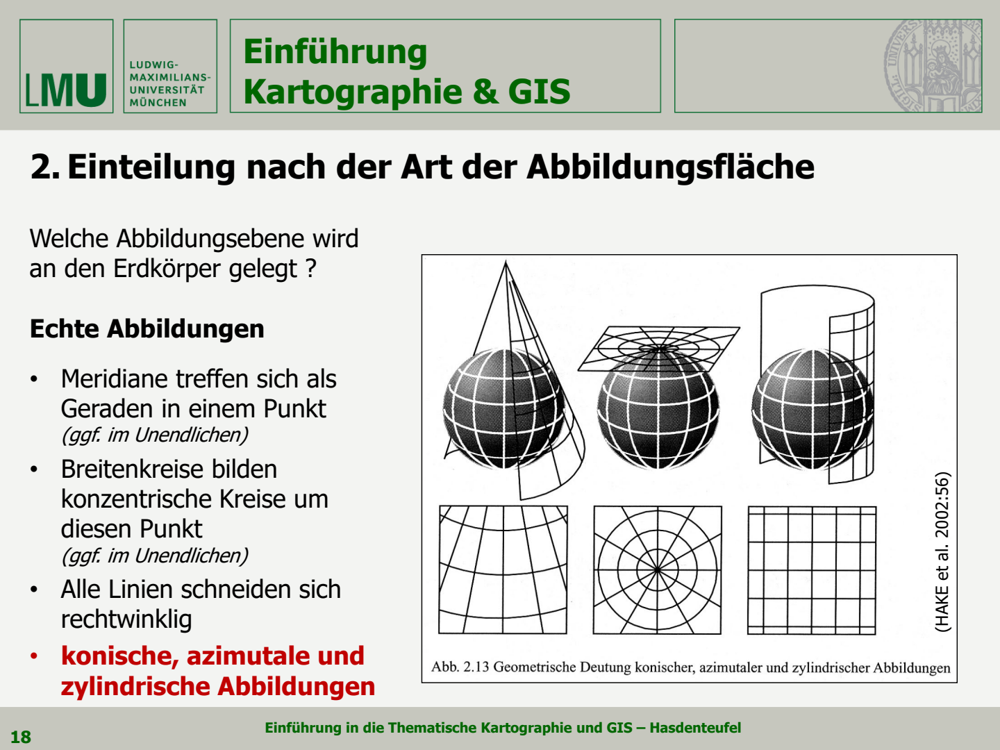
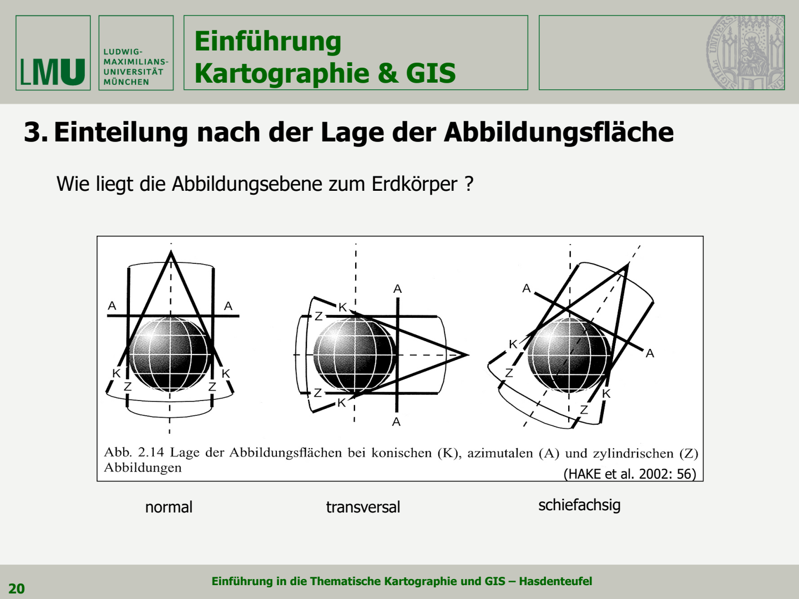
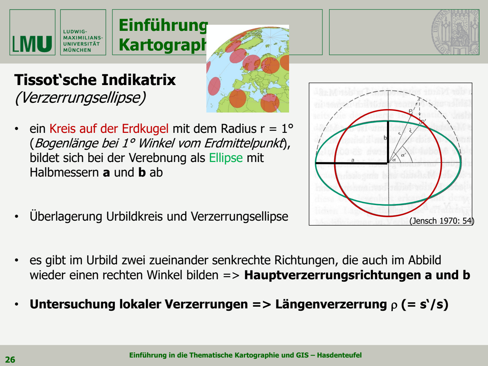
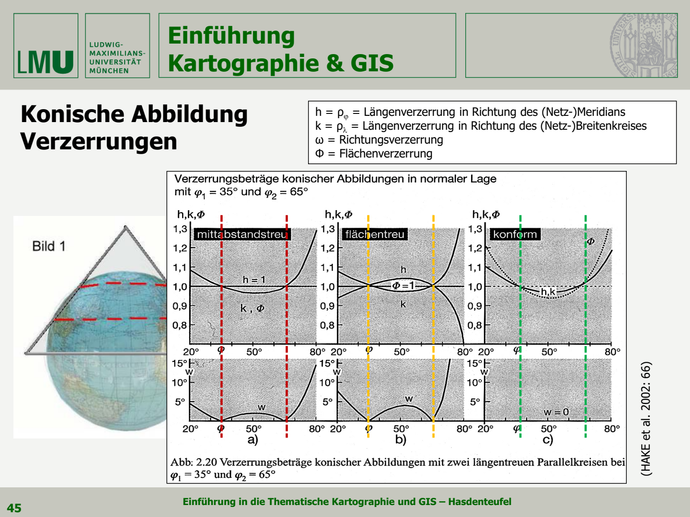
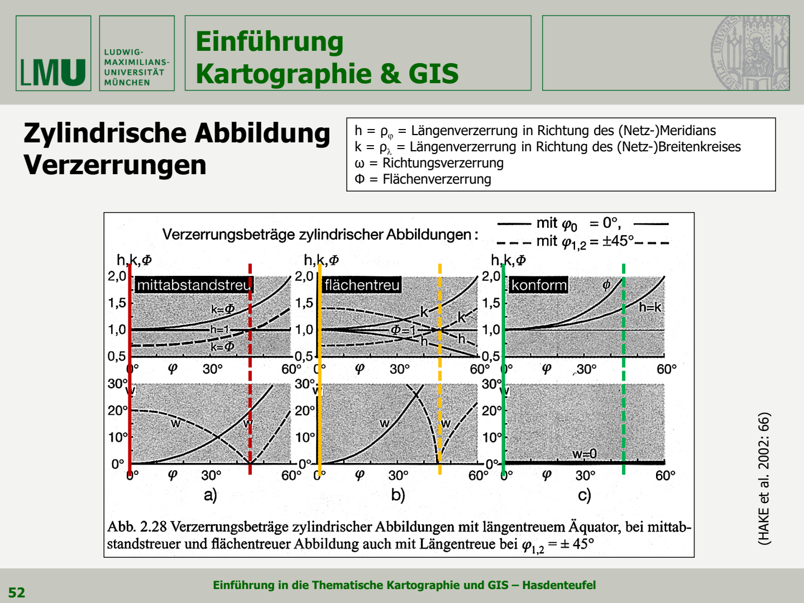
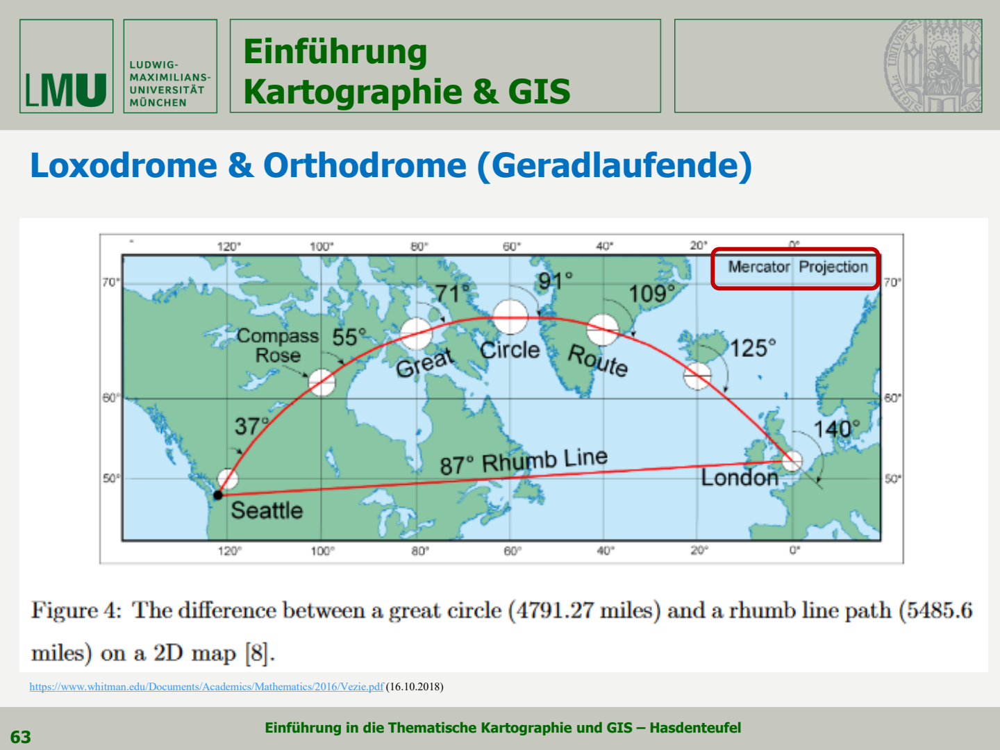
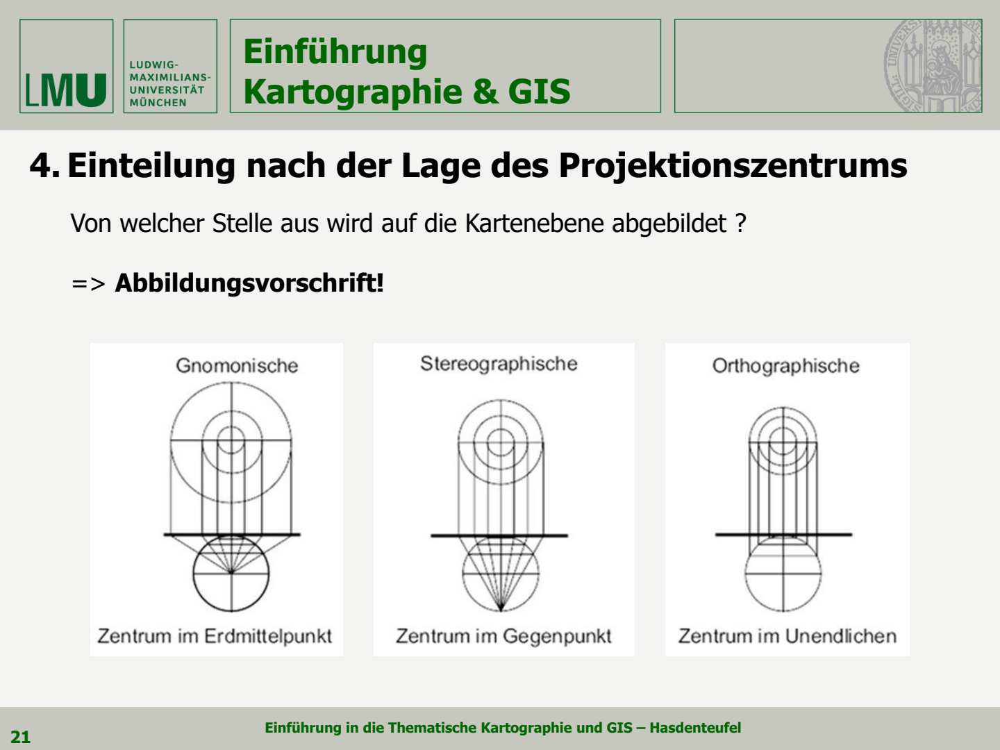
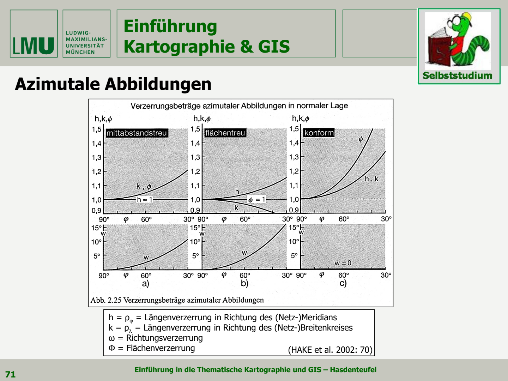
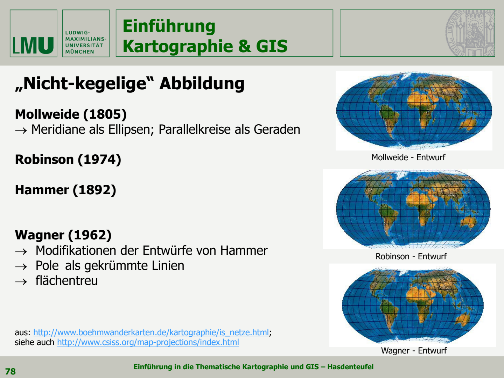

本章回答三个问题：**怎样把弯曲的地球表面画到平面上？投影会改变什么？怎样根据用途选择投影？**

学习主线：投影的定义与分类 → 长度、面积和角度变形 → 圆锥、圆柱、方位投影 → 航线与世界地图的选择。

来源：[第四讲讲义](../讲义/04_Karto_GIS_VL04_public.pdf)，共 63 页。以下均为 **PDF 页码**，不是幻灯片左下角编号。公式按球面模型解释；标为“补充理解”的内容帮助读图和计算，不代替后续椭球投影公式。

## 一. 地图投影是什么

来源：第 2–7 页；视频 04.1。

### 1.1 从第三章到第四章

第三章先确定地球模型及其定位：椭球、Geoid、大地基准；本章讨论怎样把参考曲面上的点转到地图平面。

**Kartennetzentwurf / Kartenabbildung / Kartenprojektion：地图投影。** 它通过数学规则，将球面或椭球面上的坐标网与点映射到平面，为地图提供几何基础。

- **Urbild，原像**：球面／椭球面上的位置与网线。
- **Abbild，像**：投影平面中的位置与网线。
- **Abbildungsgleichung，投影方程**：把经纬度转换为平面坐标的计算规则。

一般可写为：

$$
x=f(\varphi,\lambda),\qquad y=g(\varphi,\lambda)
$$

这里 $\varphi$ 是纬度、$\lambda$ 是经度；$x,y$ 的方向由具体公式约定。**投影既可用几何图解释，也可由数学公式构造，不一定相当于从某个灯泡向外投影。**

### 1.2 为什么一定会变形

球面不能在不拉伸、不压缩、不切开的情况下完整铺平，像橘子皮不能直接压成完整平面。因此，地图无法在一个区域内同时完全保持所有长度、面积和角度。

**投影的任务是合理安排变形，而不是消除一切变形。**

讲义将较大比例尺测绘与椭球联系，将小比例尺世界图与球体近似联系，球体半径约为 $R=6371\,\mathrm{km}$。其中出现 1∶500,000、1∶2,000,000 等教学分界；它们不是固定技术界线，实际选择仍取决于精度和用途。

### 1.3 投影选择的五个依据

- **表达的信息**：比较面积、规划路线，还是展示空间分布？
- **目标读者**：专业测量、导航人员，还是一般读者？
- **区域大小、位置、形状与比例尺**：赤道、极区、中纬度区域需求不同。
- **允许的变形与图面形态**：优先等积、等角，还是整体均衡？
- **已有资料与系统要求**：是否需要衔接既有地图、坐标系统和数据？

## 二. 投影的五个分类角度

来源：第 8–16 页。分类角度可以组合，例如“正轴＋等角＋圆柱”描述的是同一个投影的三个方面。

### 2.1 按坐标网与适用范围

| 类别 | 德语 | 讲义中的典型特点 |
|---|---|---|
| 地理投影／经纬网投影 | geographische Abbildung / Gradnetzentwurf | 全球或大范围，常作球面近似；以经纬网表达位置 |
| 大地测量投影 | geodätische Abbildung | 区域测绘，常基于椭球；使用米制平面坐标与直角网格 |

**经纬网 Gradnetz 与坐标格网 Kartengitter 要区分。** 经纬线间距通常用角度表示；UTM 千米网用平面长度表示。现代测绘也采用全球地心参考系统，不限于局部最贴合椭球。

### 2.2 按投影面和网线结构

| 类型 | 德语 | 正轴时的典型网形 |
|---|---|---|
| 圆锥投影 | konische Abbildung | 经线汇聚，纬线为同心圆弧 |
| 圆柱投影 | zylindrische Abbildung | 经线、纬线均为互相垂直的平行直线组 |
| 方位投影 | azimutale Abbildung | 极地方位图中，经线放射、纬线为同心圆 |

图 1：第 10 页。上方看投影面，下方看展开后的网形。圆柱可理解为圆锥顶点移到无穷远、平面可理解为圆锥的另一极限情形。

讲义将这些规则网形归入 **echte Abbildungen（真投影／规则投影）**；将不遵循这套简单网形的数学构造、混合投影和变形地图列为 **unechte Abbildungen（非真投影／非规则投影）**。

“非真”不是不准确或不科学，也不等于“不等积”；Mollweide 就是非规则网形的等积投影。经纬线是否正交与是否处处等角也不是一回事。

### 2.3 按投影面的轴向

| 轴向 | 德语 | 初学者理解 |
|---|---|---|
| 正轴 | normal / polständig | 投影轴与地球自转轴一致；圆柱常围绕赤道，方位面常切于极点 |
| 横轴 | transversal / querachsig | 投影轴与自转轴垂直；可把投影面“转过 90°”理解 |
| 斜轴 | schiefachsig | 投影轴与自转轴成其他角度 |

图 2：第 12 页。按列比较轴向，按图中字母区分圆锥、平面与圆柱。**变换轴向可以把较小变形区域移到目标地区附近。**

前述简单经纬网形主要对应正轴情形，不能原样套到横轴和斜轴图上。

### 2.4 按透视投影的视点

| 名称 | 视点位置 | 重要特点 |
|---|---|---|
| Gnomonische Projektion 心射投影 | 球心 | 球面大圆映成直线 |
| Stereographische Projektion 球面立体／球极平面投影 | 切点的对跖点 | 等角；视点并非球心 |
| Orthographische Projektion 正射投影 | 无穷远，投影线平行 | 类似从远处看地球；不是等积或等角 |

**切点／图面中心**是要表现的中心位置；**透视视点**是投影线出发处，二者不同。这里的 Stereographisch 是投影名称，不是第三章立体影像的含义。

### 2.5 按保持的性质

- **Längentreue / Äquidistanz：等距**，只保持指定线、方向或相对指定中心的距离。
- **Flächentreue / Äquivalenz：等积**，保持面积比例。
- **Winkeltreue / Konformität：等角／保角**，保持局部角度。
- **vermittelnde Abbildung：折中投影**，不严格保持前三项，追求变形较均衡。

等角与等积不能在一个非零面积区域内同时完全实现。等距也不意味着任意两点间距离都能直接量取。

## 三. 变形与 Tissot 指示椭圆

来源：第 17–27 页；视频 04.2。

### 3.1 长度比例因子

讲义用 $\rho=s'/s$ 表示长度变形。严格理解局部性质时，应取很短线段：

$$
\rho=\frac{\mathrm ds'}{\mathrm ds}
$$

$s$ 为原曲面长度，$s'$ 为投影后的对应长度；比较时先消除地图整体缩小比例。

- $\rho=1$：该点该方向无长度变形。
- $\rho>1$：拉伸；$\rho<1$：压缩。
- $\rho$ 不仅随地点变化，也可随**同一点的方向**变化。

### 3.2 一个小圆怎样变成椭圆

**Tissot’sche Indikatrix（Tissot 指示椭圆／变形椭圆）**：在地球表面画一个极小圆，投影后一般成为椭圆，用其形状、大小和方向表示局部变形。

讲义用半径为 1° 的圆作示意；严格的指示椭圆描述的是无穷小邻域，不能把任意大圆形区域都当成只会变成椭圆。

图 3：第 18 页。观察圆变成椭圆后哪一方向拉长、哪一方向压缩；椭圆方向也提供信息。

| 符号 | 德语／含义 |
|---|---|
| $h=\rho_\varphi$ | 沿经线方向的长度比例因子 |
| $k=\rho_\lambda$ | 沿纬线方向的长度比例因子 |
| $a=\rho_{\max}$ | 最大长度比例因子，椭圆长半轴 |
| $b=\rho_{\min}$ | 最小长度比例因子，椭圆短半轴 |
| $\omega$ | 讲义使用的方向变形量 Richtungsverzerrung |
| $\Phi$ | 面积比例因子 Flächenverzerrung |

$a,b$ 取原圆半径为 1 时的归一化值。两个主变形方向 Hauptverzerrungsrichtungen 互相垂直，投影后仍互相垂直；它们不一定总是经纬线方向。规则正轴投影中常与经纬方向一致。

**符号提醒：** 本章的 $a,b$ 是变形椭圆半轴，不是第三章地球椭球半轴；$h$ 是长度比例因子，不是椭球高。

### 3.3 三种保持性质怎样判断

| 性质 | 条件 | 观察椭圆时看什么 |
|---|---|---|
| 等角 | $a=b$ | 小圆仍是圆，但不同位置的圆可大小不同 |
| 等积 | $ab=1$ | 椭圆与原单位圆面积相同，可一边拉长、一边压扁 |
| 主方向局部等距 | $a=1$ 或 $b=1$ | 至少一个主方向长度不变；不代表任意两点等距 |
| 局部无变形 | $a=b=1$ | 该点各方向长度与角度均保持 |

面积比例因子：

$$
\Phi=\frac{\mathrm dA'}{\mathrm dA}=ab
$$

若投影后的经纬网也正交，可写成 $\Phi=hk$；非正交网不能直接把两方向长度因子相乘。

因此：**等角不等于等积，等积也不等于形状不变。** 等角保持的是无穷小局部形状，大洲整体外形仍可能明显变形。

### 3.4 方向变形公式

按第 20 页图的轴向约定，局部坐标满足 $y'=ay$、$z'=bz$，故：

$$
\frac{\tan\alpha'}{\tan\alpha}=\frac{a}{b},\qquad
\sin\omega=\frac{a-b}{a+b}
$$

这里 $\omega$ 是图中单个方向偏转的最大值。若教材把“两条线夹角的最大改变”记作角变形，其值为 $2\omega$，须先看符号定义。入门先记住：$a=b$ 时方向变形为零，长短轴差异越大，角度变形越明显。

## 四. 圆锥投影 Konische Abbildungen

来源：第 28–36 页；视频 04.3。

### 4.1 构造与网形

将圆锥套在地球上，再展开锥面：

- **Berührungskegel，切圆锥**：一条标准纬线 $\varphi_0$。
- **Schnittkegel，割圆锥**：两条标准纬线 $\varphi_1,\varphi_2$。
- 标准纬线 Standardparallel／Berührungsbreitenkreis：按所用投影规定沿线长度比例为 1 的纬线。

正轴网形：经线为相交直线，纬线为同心圆弧，经纬线正交；靠近锥顶的一极常映成点。另一极的表现取决于具体投影。

圆锥展开后，经线之间的图面夹角通常小于原经差。第 30 页切圆锥的几何示意可写为：

$$
\delta=\frac{\pi}{2}-\varphi_0,\qquad
r_0=R\tan\delta=R\cot\varphi_0,\qquad
\theta=\Delta\lambda\sin\varphi_0
$$

$r_0$ 是锥顶到标准纬线的斜距，$\theta$ 是展开图面夹角；该式解释切圆锥几何，**不是全部圆锥投影通用的完整方程**。

### 4.2 三种圆锥投影与变形

| 类型 | 德语 | 判断要点 |
|---|---|---|
| 等距圆锥 | mittabstandstreu / abstandstreu | 沿经线方向比例不变，常见 $h=1$ |
| 等积圆锥 | flächentreu | 面积比例 $\Phi=hk=1$，两方向伸缩互相补偿 |
| 等角圆锥 | winkeltreu / konform | $h=k$，方向变形为零 |

讲义图例包括等积圆锥、Ptolemäus 等距圆锥和 Lambert 等角圆锥，部分示例标准纬线为北纬 45°。**“圆锥”只说投影家族，具体保持什么还要看后半个名称。**

图 4：第 35 页，标准纬线为北纬 35°、65°。从左到右为等距、等积、等角。

读图方法：

- 纵轴 $h,k,\Phi$ 的 **1 表示对应比例不变**；下排 $\omega=0$ 表示方向无变形。
- 左图 $h=1$；中图 $\Phi=1$；右图 $h=k$ 且 $\omega=0$。
- 两条标准纬线使较小变形分布在目标纬度带附近；偏离适用区域后变形增大。

圆锥投影常用于中纬度、东西向较长区域。不是因为圆锥天然无变形，而是其标准纬线容易贴合这样的地区。

### 4.3 多圆锥思路

**Polykonische Abbildungen，多圆锥表达**：不同纬度带或图幅行采用不同圆锥，使每一行更适合本地纬度。

第 36 页以 IWK 1∶1,000,000、每行纬差 $\Delta\varphi=4^\circ$ 示意。重点是**分区改善局部变形**；不同圆锥的图幅展开后可能不能无缝铺成同一平面。这里是讲义的分幅构造说明，不应理解为所有多圆锥投影都等角。

## 五. 圆柱投影与 Mercator

来源：第 23–26、37–46 页；视频 04.4。

### 5.1 构造与正轴网形

- **Berührungszylinder，切圆柱**：正轴时常切于赤道。
- **Schnittzylinder，割圆柱**：正轴时通常有南北两条标准纬线。
- 圆柱展开成矩形；经线为等间距平行直线，纬线为与其垂直的平行直线。
- 各纬线在图上与赤道同长，而球面纬线随纬度升高而缩短，因此必须调整伸缩。

真实透视图可以帮助理解圆柱几何，但 Mercator 的关键是数学上配合两方向伸缩，不是简单从球心投影到圆柱。

### 5.2 三种正轴切圆柱的公式

以下采用球面、赤道长度比例为 1；令 $x$ 向东、$y$ 向北，中央经线为 $\lambda_0$，则 $\Delta\lambda=\lambda-\lambda_0$，且

$$
x=R\Delta\lambda
$$

三者主要区别在纬度如何变成纵坐标：

| 投影 | 纵坐标 $y$ | 经向 $h$ | 纬向 $k$ | 面积因子 $\Phi$ |
|---|---|---|---|---|
| 等距圆柱／方格投影 Quadratische Plattkarte | $R\varphi$ | $1$ | $1/\cos\varphi$ | $1/\cos\varphi$ |
| Lambert 等积圆柱 | $R\sin\varphi$ | $\cos\varphi$ | $1/\cos\varphi$ | $1$ |
| Mercator 等角圆柱 | $R\ln\tan(\pi/4+\varphi/2)$ | $1/\cos\varphi$ | $1/\cos\varphi$ | $1/\cos^2\varphi$ |

**角度进入这些坐标公式时使用弧度；$R$ 与坐标采用相同长度单位。** 讲义的 $m'_\varphi$ 对应从赤道起算的图上经线弧长，可与这里的 $y$ 联系；$p'_\varphi=2\pi R$ 表示纬线在完整展开图上同长。

- 等距圆柱：纬线等间隔，经线方向距离保持；高纬东西向拉长。
- 等积圆柱：高纬纬线间隔压缩，补偿东西向拉伸；Behrmann 是讲义中的等积割圆柱示例。
- Mercator：高纬纬线间隔扩大，使南北和东西方向按同样比例伸长。

### 5.3 Mercator 为什么等角却严重夸大面积

Mercator（Gerhard Kremer）于 1569 年用于世界图。球面正轴切圆柱情况下：

$$
h=k=\sec\varphi=\frac{1}{\cos\varphi},\qquad
\Phi=\sec^2\varphi
$$

在北纬 60°，$h=k=2$，局部长度约放大 2 倍，面积约放大 4 倍，小圆仍是圆。

纬度越接近两极，变形越大；极点对应无穷远，无法在有限的标准 Mercator 图面上画出。它适合恒定航向的导航表达，不适合凭图面大小比较全球面积。[Mercator 性质说明，Esri](https://pro.arcgis.com/en/pro-app/3.5/help/mapping/properties/mercator.htm)

讲义中的十进对数形式与自然对数形式等价：$\ln t=\ln(10)\log_{10}t\approx2.302585\log_{10}t$。因此投影纵坐标也写为：

$$
y\approx2.302585R\log_{10}\tan\left(45^\circ+\frac{\varphi}{2}\right)
$$

这一写法的三角函数用度；不要与上一表的弧度制混用。

### 5.4 割圆柱 横轴与曲线图

使用割圆柱可把无长度变形纬线移到目标纬度附近，重新分配变形。标准纬线为 $\pm\varphi_s$ 时，正轴圆柱的纬向比例可写为：

$$
k=\frac{\cos\varphi_s}{\cos\varphi}
$$

在标准纬线上 $k=1$；内侧可能压缩、外侧可能拉伸。经向比例仍取决于等积、等距或等角的具体公式。

图 5：第 41 页。实线以赤道为标准纬线；部分虚线示例采用南北纬 45°。比较左侧 $h=1$、中间 $\Phi=1$、右侧 $h=k$ 与下排角度变形。

**横轴等角圆柱 querachsiger winkeltreuer Zylinderentwurf** 把轴转向，讲义以 Gauß-Krüger 为例，UTM 也属于横轴墨卡托家族。此时不能继续把赤道当作全部投影的低变形中心；分带和标准线安排将在第五讲展开。

## 六. 球面上的航线 Orthodrome 与 Loxodrome

来源：第 47–52 页；视频 04.5。

### 6.1 大圆与小圆

- **Großkreis，大圆**：圆所在平面通过球心；赤道和完整经线圈属于大圆。
- **Kleinkreis，小圆**：所在平面不通过球心；除赤道外的纬线是小圆。
- 单条经线通常是大圆的一半；讲义“经线是大圆”可理解为完整经线圈。

### 6.2 两种航线的区别

| 比较项 | Orthodrome 大圆航线 | Loxodrome 等角航线 |
|---|---|---|
| 德语别名 | Geradlaufende；球面 Geodäte | Schieflaufende、Kursgleiche、Winkelgleiche |
| 英语 | great-circle route | rhumb line |
| 定义 | 球面两点间较短的大圆弧 | 与各经线保持恒定夹角的曲线 |
| 是否最短 | 是，针对球面上的较短弧 | 通常不是 |
| 航向／Azimut | 通常沿途变化 | 恒定 |
| 普通正轴 Mercator 图上 | 通常弯曲 | 直线 |
| 球面 Gnomonic 图上 | 直线 | 通常弯曲 |

特殊情况：沿经线或赤道走时，两类航线可以重合。对跖点之间的最短大圆弧不唯一。

图 6：第 51 页，Seattle–London。上方大圆航线向北弯，但实际球面路线较短；下方近水平的等角航线是直线，却更长。**平面上看着直，不代表球面上最短。**

讲义中“直线切过所有经线且夹角不变”的说法应联系 Mercator 图理解，不能把它当成球面三维空间中的直线。类似地，“只在某投影中为直线”描述的是整个航线族的性质，不否认其他投影中存在个别直线经线或赤道。

### 6.3 导航与距离的实际含义

- Mercator 的直线便于保持恒定地理航向，但不保证最省路程。
- Gnomonic 可用直线寻找球面大圆路线，再转绘到航海图。
- 航空图上跨洋路线弯曲，往往是投影造成的视觉效果；实际航路还会受风、空域等因素影响。
- 椭球上应使用椭球测地线；“大圆最短”是本章球面模型的表述。

补充理解：若两点球面坐标为 $(\varphi_1,\lambda_1)$、$(\varphi_2,\lambda_2)$，中心角为 $c$：

$$
\cos c=\sin\varphi_1\sin\varphi_2+
\cos\varphi_1\cos\varphi_2\cos(\lambda_2-\lambda_1),\qquad d=Rc
$$

最后的 $c$ 必须用弧度，$d$ 是大圆短弧长度。讲义以 Great Circle Mapper 中 MUC–SFO 等路线帮助比较不同投影下的形状。

## 七. 方位投影 Azimutale Abbildungen

来源：第 13、53–59 页；视频 04.6。

### 7.1 构造与网形

用平面与球相切 Tangentialebene，或用截平面 Schnittebene 构造表达。方位投影的典型特点是**从图面中心出发的方位关系保持**，不表示任意两点间所有方位均不变。

正轴、极地情形：经线是从极点向外的放射直线，纬线是以极点为圆心的同心圆；经线图面夹角等于经差，即 $\varepsilon=\Delta\lambda$。横轴和斜轴时，地理经纬网不再全部保持这种外观。

### 7.2 三种透视方位投影

图 7：第 13 页。左为球心视点，中为对跖点视点，右为无穷远平行视线。

| 投影 | 保持／表达特点 | 变形与范围 |
|---|---|---|
| Gnomonic 心射 | 球面所有大圆弧映为直线 | 非等角、非等积；离中心迅速放大，不能在有限图面上表示离中心达 90°的点 |
| Stereographic 球面立体 | 等角，小圆局部仍为圆 | 面积与距离随远离中心而放大；对跖点不能有限表示 |
| Orthographic 正射 | 类似从远处观察地球 | 通常表示可见半球；边缘压缩，不等距、等角或等积 |

球面心射投影的大圆直线性质不能直接扩大成“所有椭球测地线都精确为直线”；椭球推广需要另行考虑。[PROJ 心射投影说明](https://proj.org/en/stable/operations/projections/gnom.html)

### 7.3 等距与等积方位投影

- **Mittabstandstreue Azimutalprojektion，方位等距投影**：从中心到各点的距离保持；任意两个非中心点之间距离仍可能失真。
- **Lambert flächentreue Azimutalprojektion，Lambert 方位等积投影**：面积保持，图形和角度可变化。
- **Winkeltreue Azimutalprojektion，等角方位投影**：本讲的代表是 Stereographic。

方位等距和 Lambert 方位等积主要由数学关系定义，不必对应单一固定视点。**按“视点”分类和按“保持性质”分类不是同一套名单。**

补充理解：令 $c$ 为点与中心之间的球心角，$r$ 为图上离中心的距离；常见球面切面形式为：

| 投影 | 径向关系 $r(c)$ |
|---|---|
| 心射 | $R\tan c$ |
| 球面立体 | $2R\tan(c/2)$ |
| 正射 | $R\sin c$ |
| 方位等距 | $Rc$ |
| Lambert 方位等积 | $2R\sin(c/2)$ |

$c$ 使用弧度。公式表达同一个道理：**各类投影保持相同中心方向，但决定图上半径的方式不同。**

### 7.4 变形曲线怎样读

图 8：第 57 页，极地正轴示例。横轴从北纬 90°向较低纬展开，意味着离投影中心越来越远。

- 等距：径向即经向 $h=1$，环向 $k$ 与面积因子随离中心增大。
- 等积：$\Phi=hk=1$，径向与环向的伸缩互相补偿。
- 等角：$h=k$、$\omega=0$，但长度和面积放大。

极区与围绕一个中心的半球图常考虑方位投影；低变形位置取决于所选中心。讲义“离极点变形增大”对应极地示例，推广时应说“离投影中心”。

## 八. 非规则投影与混合世界地图

来源：第 11、27、60–62 页；视频 04.7。

### 8.1 为什么不只使用简单圆锥、圆柱和平面

完整世界图还要兼顾大陆外形、整体轮廓和视觉均衡，因此可通过数学构造调整经纬线、组合不同投影。

- **Planisphäre，平面世界图**：在平面上表现全球或广阔范围。
- **Planigloben，半球图**：用一个或多个半球图面表达地球。
- **Mischkarte / Mischprojektion，混合投影图**：组合不同投影关系。
- **Anamorphose / Kartogramm，变形地图／统计变形图**：有意改变地区大小或位置，以表达人口等变量。

统计变形图中，地区大小可能表示人口而非土地面积，不能用通常地理面积的读法解释。

### 8.2 讲义中的主要投影

| 名称 | 网形／构造重点 | 性质 |
|---|---|---|
| Winkel，讲义所举混合投影 | 结合等距圆柱与 Aitoff 构造，调整整体世界图 | 折中；不能因组成中有等距投影就认定整体等距 |
| Mollweide | 中央经线为直线，其他经线为椭圆弧；纬线为直线，整体椭圆 | 等积 |
| Robinson | 纬线为平行直线，经线弯曲，极点表现为线段 | 折中，兼顾整体外形 |
| Hammer | 从 Lambert 方位等积关系发展出的世界图，椭圆轮廓 | 等积 |
| Wagner，讲义所示方案 | 对 Hammer 等方案作改造；示例极点表现为弯曲线 | 讲义所示版本等积；Wagner 还有其他编号方案，须看具体名称 |

图 9：第 62 页。对比经线曲率、纬线形状与极点表现。**非规则投影不等于折中投影**：Mollweide 等仍严格等积；Robinson 则不严格等积或等角。

这里重点掌握网形与性质，不把作者姓名、年份或模糊简称当成完整投影定义。

## 九. 怎样选投影与辨认地图

来源：第 7、63 页，并综合本讲。

### 9.1 按用途选择

| 问题／用途 | 优先考虑 | 原因 |
|---|---|---|
| 比较国家、土地或生态区域面积 | 等积投影 | 面积比例有意义 |
| 航海中的恒定航向 | 普通 Mercator | 等角航线为直线 |
| 表现球面最短路线 | Gnomonic 辅助规划 | 大圆为直线，但不能直接量出真实长度 |
| 以一座城市为中心比较距离 | 该城为中心的方位等距 | 仅中心到各点距离保持 |
| 中纬度、东西向区域 | 合适的圆锥投影 | 易把标准纬线放在区域内 |
| 狭长南北向测绘区域 | 合适分带的横轴投影 | 将较小变形区布置在目标区域附近 |
| 一般世界概览 | 合适的折中投影，或按主题用等积投影 | 平衡整体外形或保证面积比较 |

选择后还应检查基准、中央经线、标准纬线、图面中心和单位。**同名投影使用不同参数，图面外观与变形分布也会不同。**

### 9.2 初学者读图的四步

1. **看经纬网形**：直线、圆弧、同心圆还是复杂曲线？
2. **看中心与标准线**：较小变形大致安排在哪里？
3. **看保持条件**：$h=1$、$\Phi=1$、$h=k$ 分别说明什么？
4. **看用途是否匹配**：是否拿非等积图比较面积、拿非等距图直接量距离？

仅凭大致轮廓不一定能唯一识别投影，应结合图例、参数和说明。

### 9.3 最容易混淆的关系

| 错误理解 | 正确理解 |
|---|---|
| 投影就等于改变大地基准 | 基准定义空间参考，投影处理曲面到平面 |
| 经纬线正交就一定等角 | 正交网格只是部分角度关系；等角要求各方向局部同比例 |
| 指示圆还是圆，就没有变形 | 可以在各方向等比例放大，面积仍会改变 |
| 等积就保持国家外形 | 保持面积比例，不保证形状与角度 |
| 等距就能量任意两点距离 | 必须说明保持的是哪条线、方向或中心距离 |
| Mercator 上直线最短 | 直线通常是恒定航向，最短路线通常是弯曲的大圆弧 |
| 方位投影一定是极地地图 | 可取正轴、横轴、斜轴，中心不限于极点 |
| 所有投影都从球心向外投射 | 很多由数学条件定义，无单一透视视点 |
| 所有非规则投影都不等积 | Mollweide、Hammer 等是等积方案 |

## 十. 计算与读图小例题

这些例题用于掌握本讲关系，均先消除地图整体缩小比例。

1. **指示椭圆 $a=2$、$b=0.5$，是否等积、等角？**  
   $ab=1$，所以等积；$a\ne b$，所以不等角。一个方向伸长、另一个方向压缩，面积可互相补偿。

2. **指示圆 $a=b=1.5$，面积有没有变化？**  
   等角，但 $\Phi=ab=2.25$，局部面积放大 2.25 倍。

3. **切圆柱 Mercator 在北纬 60°的局部变形是多少？**  
   $h=k=1/\cos60^\circ=2$，$\Phi=4$。地图上该处小圆仍圆，不意味着比例尺与赤道相同。

4. **方位等距图上，中心 A 到 B、C 的距离都准确，能否保证 B 到 C 准确？**  
   不能。保持中心距离不等于保持所有点对距离。

5. **球面两点相距中心角 30°，取 $R=6371\,\mathrm{km}$，最短距离多长？**  
   $c=30^\circ\times\pi/180^\circ=\pi/6$，故 $d=6371\pi/6\approx3335.85\,\mathrm{km}$。

6. **心射图中两城直线连接，是否能直接按统一比例尺量出航程？**  
   不能。直线指明球面大圆路线，但沿线长度比例仍会变化。

7. **正轴等距圆柱在北纬 60°是否等角？**  
   $h=1$、$k=2$，所以不等角；面积因子 $\Phi=2$。这里的“等距”主要指经线方向。

讲义末页要求掌握四项：投影分类、Tissot 变形、真投影的构造／网形／性质，以及 Orthodrome 与 Loxodrome。回看对应章节时，先解释“保什么、在哪里保”，再记名称。
